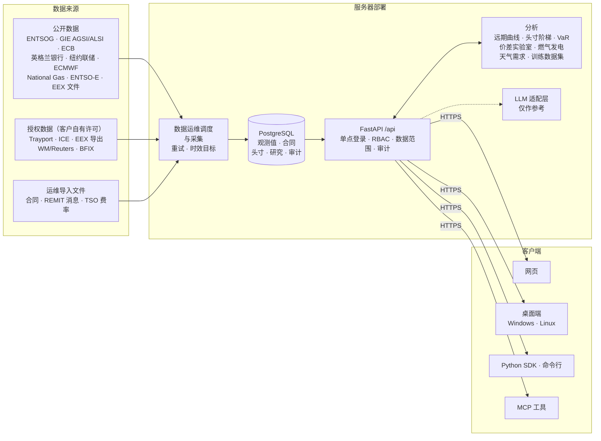

# Eurogas Nexus

[English](README.md) · **简体中文**

[](https://github.com/AlexYuhuFeng/EurogasNexus/actions/workflows/ci.yml)
[](https://github.com/AlexYuhuFeng/EurogasNexus/actions/workflows/release.yml)
[](https://github.com/AlexYuhuFeng/EurogasNexus/releases)

**面向欧洲天然气交易团队的决策支持工作台。** 交易员、分析师、风控、管理层与合规人员在同一处查看
价格、基本面、头寸与研究结果；使用交易台惯用单位（p/th、EUR/MWh、MWh/d），数据来自客户自有的
授权行情。

软件包版本：`0.6.0` · 渠道：`preview` · 状态：已测试本地范围的候选版本，尚非生产或正式（GA）版本。

本文是英文 [README.md](README.md) 的中文版，内容与之对应；如有出入，以英文版为准。

## 功能概览

| 领域 | 主要内容 |
|---|---|
| **市场** | NBP、TTF、THE、PEG、ZTP、PSV 的枢纽行情板与交易屏式报价梯（WD、DA、WE、BOM、月度、季度、季节、年度）；对 TTF 价差；合约条带；单位与汇率换算；储气量对照欧盟目标；流量与容量网络图 |
| **基本面** | ENTSOG 流量与容量，GIE 储气与 LNG，ECB/BoE/纽约联储利率，ECMWF 气温，英国需求，ENTSO-E 电力（负荷、风电、光伏、燃气发电、电价），燃气发电（剩余负荷、点火/暗价差、燃料转换）；REMIT 停运消息 |
| **研究** | 价差实验室与声明式规则回测；策略设计、冻结回测、对比与影子运行；覆盖价格、电力、储气、LNG 与流量的时点一致（point-in-time）训练数据集，含滞后、滚动特征与前推（walk-forward）折叠；Python SDK |
| **组合与风险** | 头寸阶梯（按枢纽与月份的实物与金融头寸、对冲比例），基于远期曲线的盯市，指示性 VaR，路径经济性，容量计费，使用 SONIA/€STR/SOFR 的提前回款估值 |
| **决策** | 有证据支撑的决策案例与四眼审批，可选 LLM 解释的预警，完整审计轨迹 |
| **平台** | 单点登录（OIDC），带商业数据范围的角色权限（RBAC），个人偏好与组织默认值，中英文界面，浅色/深色，绿涨或红涨的盈亏配色，键盘优先导航 |

**边界：** 不提供下单、执行、提名（nomination）或结算，也不给出正式交易建议。所有输出均为待人工
审阅的候选结果。市场价格只来自客户自己的授权来源（Trayport、ICE、EEX）；系统从不把模拟价格显示为
市场价格。

## 使用者

| 角色 | 默认进入 | 指南（英文） |
|---|---|---|
| 交易员 | 市场 → 曲线 | [docs/guides/TRADER.md](docs/guides/TRADER.md) |
| 分析师、量化 | 市场或策略实验室 | [docs/guides/ANALYST_QUANT.md](docs/guides/ANALYST_QUANT.md) |
| 风控、财务 | 组合 → 敞口 | [docs/guides/RISK_AND_FINANCE.md](docs/guides/RISK_AND_FINANCE.md) |
| 管理层 | 组合 → 概览 | [docs/guides/MANAGEMENT.md](docs/guides/MANAGEMENT.md) |
| 法务、合规 | 决策中心 → 审阅 | [docs/guides/LEGAL_COMPLIANCE.md](docs/guides/LEGAL_COMPLIANCE.md) |
| IT 管理员、数据运维 | 管理、数据源 | [docs/guides/ADMIN_AND_OPERATIONS.md](docs/guides/ADMIN_AND_OPERATIONS.md) |

## 数据流向



每个来源都连同单位、来源引用与可得时间写入 PostgreSQL。只有 API 读取数据库；每一行都经过调用者
的数据范围检查，供应商凭据从不离开服务器。分析结果与来源说明、警告一并返回，系统不下单、不提名、
不结算。详见 [ARCHITECTURE.md](docs/architecture/ARCHITECTURE.md)（英文）。多办公室部署（英国、
加拿大、新加坡；中国独立部署）见 [GLOBAL_DEPLOYMENT.md](docs/architecture/GLOBAL_DEPLOYMENT.md)（英文）。

## 部署

两种角色：**服务器**（PostgreSQL、API、HTTPS 网关、采集任务，运行于 Docker Compose）与
**客户端**（Windows 或 Linux 桌面安装包，或浏览器）。

1. 服务器：按 [DEPLOYMENT_ROLES-CN.md](docs/deployment/DEPLOYMENT_ROLES-CN.md) 操作。Windows
   服务器使用 `Deploy-EurogasNexus.ps1 -Role Server`；Linux 服务器见
   [deploy/runtime](deploy/runtime/README-CN.md)。配置来自 `deploy/runtime/env.server.example`，
   启动时校验（`python scripts/ops/check_config.py --strict`）。
2. 登录：在身份提供方配置 OIDC（[OIDC_ACCESS_TOKEN.md](docs/operations/OIDC_ACCESS_TOKEN.md)），
   再分配角色与数据范围（[ROLES_AND_RESPONSIBILITIES.md](docs/product/ROLES_AND_RESPONSIBILITIES.md)）。
3. 数据：填入 GIE 与 ENTSO-E 密钥，启用公开数据源的调度，接入或导入授权价格
   （[LIVE_PRICE_SOURCES.md](docs/operations/LIVE_PRICE_SOURCES.md)）。
4. 客户端：安装桌面端并指向 `https://<server>/api`，或直接打开网页地址。
5. 运维：备份与恢复演练、数据保留、健康检查与指标（[docs/operations](docs/operations)）。

## 开发

环境要求：Python 3.11+、Node.js 24+、PostgreSQL 16；仅构建桌面端时需要 Rust。

```bash
python -m pip install -e ".[dev]"
alembic upgrade head                       # 需设置 RUNTIME_STORE_DATABASE_URL
uvicorn apps.api.main:app --host 127.0.0.1 --port 8000
npm --prefix clients/web ci && npm --prefix clients/web run dev
```

推送前（可安装为 `.git/hooks/pre-push`）：

```bash
bash scripts/ci/pre_push_check.sh          # ruff check .、快速 pytest、网页测试
pytest -q tests                            # 全量测试
npm --prefix clients/web run build
```

CI 另外运行 PostgreSQL 集成测试、中英文浏览器验收与无障碍检查、原生桌面构建、SDK 验收，以及许可证
与漏洞审计。见 [Validation](docs/operations/VALIDATION.md)、
[Release readiness](docs/release/RELEASE_READINESS.md) 与
[CI and branch protection](docs/engineering/CI_AND_BRANCH_PROTECTION.md)（英文）。

## 版本与发布

遵循[语义化版本](https://semver.org/lang/zh-CN/)：候选版本标记为 `vX.Y.Z-rc.N` 并作为 GitHub
预发布（pre-release）发布，正式版本标记为 `vX.Y.Z`。`main` 分支的预览构建只作为工作流产物保存，不
作为发布。变更内容见[更新日志](CHANGELOG.md)，发布流程见
[RELEASE_CHANNELS.md](docs/release/RELEASE_CHANNELS.md)（英文）。

## 文档导航

- [按角色的指南](docs/guides/README.md)（英文）
- [中文文档索引](docs/README-CN.md) · [Documentation index](docs/README.md)
- [架构](docs/architecture/ARCHITECTURE.md) ·
  [架构决策](docs/architecture/ARCHITECTURE_DECISION_RECORD.md) ·
  [项目目录与归属](PROJECT_DIRECTORY.md)
- [术语](docs/architecture/TERMINOLOGY-CN.md) ·
  [API 合同演进政策](docs/architecture/API_CONTRACT_EVOLUTION_POLICY-CN.md)
- [从交易公司视角的评估](docs/product/TRADING_HOUSE_ASSESSMENT.md)（英文）
- [数据来源条款](docs/legal/DATA_SOURCE_TERMS.md) ·
  [依赖许可证](docs/legal/DEPENDENCY_LICENSE_REVIEW.md) ·
  [第三方声明](THIRD_PARTY_NOTICES.md)

## 安全与许可

专有软件，源码可见。不得提交凭据、授权供应商数据、客户合同或部署细节。漏洞报告方式见
[SECURITY.md](SECURITY.md)；贡献规则见 [CONTRIBUTING.md](CONTRIBUTING.md)；许可条款见
[LICENSE](LICENSE)。
