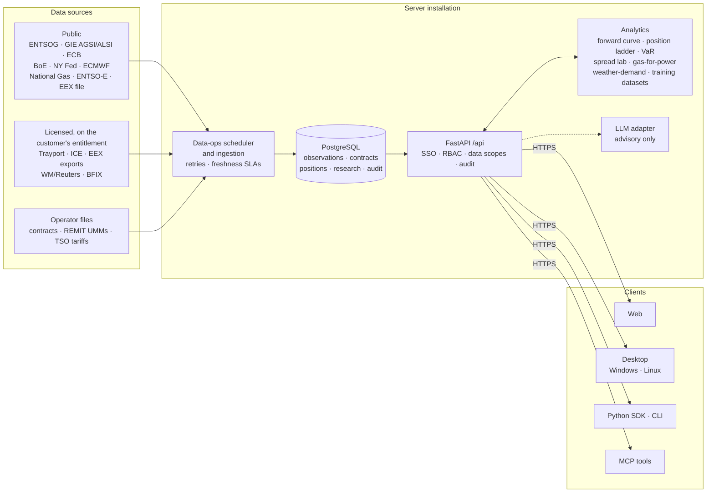

# Eurogas Nexus

**English** · [简体中文](README-CN.md)

[](https://github.com/AlexYuhuFeng/EurogasNexus/actions/workflows/ci.yml)
[](https://github.com/AlexYuhuFeng/EurogasNexus/actions/workflows/release.yml)
[](https://github.com/AlexYuhuFeng/EurogasNexus/releases)

**A decision-support workstation for European gas trading desks.** Traders, analysts,
risk, management and compliance staff read prices, fundamentals, positions and research
in one place, in desk units (p/th, EUR/MWh, MWh/d), on their own licensed market data.

Package version: `0.6.0` · Channel: `preview` · Status: release candidate for the tested
local scope, not a production or GA release.

## What it does

| Area | Highlights |
|---|---|
| **Market** | Hub board and execution-style ladder (WD, DA, WE, BOM, months, quarters, seasons, Cal) for NBP, TTF, THE, PEG, ZTP, PSV; spreads to TTF; product strip; unit and FX converter; storage against EU targets; network map of flows and capacity |
| **Fundamentals** | ENTSOG flows and capacity, GIE storage and LNG, ECB/BoE/NY Fed rates, ECMWF temperature, GB demand, ENTSO-E power (load, wind, solar, gas generation, prices), gas-for-power (residual load, spark/dark spreads, fuel switch); REMIT outage messages |
| **Research** | Spread lab with declared-rule backtests; strategy design, frozen backtests, comparison and shadow runs; point-in-time training datasets over prices, power, storage, LNG and flows with lags, rolling features and walk-forward folds; Python SDK |
| **Portfolio and risk** | Position ladder (physical and financial by hub and month, hedge ratio), mark-to-market on the forward curve, indicative VaR, route economics, capacity billing, early-cash valuation with SONIA/€STR/SOFR |
| **Decisions** | Evidence-backed decision cases with four-eyes approval, alerts with optional LLM explanations, full audit trail |
| **Platform** | SSO (OIDC), RBAC with commercial data scopes, per-user preferences and organisation defaults, English and Chinese, light/dark, green-up or red-up P&L colours, keyboard-first navigation |

**Boundary:** no order entry, execution, nomination or settlement, and no official
trading recommendations. Every output is a candidate for human review. Market prices come
only from the customer's own licensed sources (Trayport, ICE, EEX); the product never
shows a simulated price as a market price.

## Who uses it

| Role | Lands on | Guide |
|---|---|---|
| Trader | Market → Curves | [docs/guides/TRADER.md](docs/guides/TRADER.md) |
| Analyst, quant | Market or Strategy Lab | [docs/guides/ANALYST_QUANT.md](docs/guides/ANALYST_QUANT.md) |
| Risk, finance | Portfolio → Exposure | [docs/guides/RISK_AND_FINANCE.md](docs/guides/RISK_AND_FINANCE.md) |
| Management | Portfolio → Overview | [docs/guides/MANAGEMENT.md](docs/guides/MANAGEMENT.md) |
| Legal, compliance | Decision Center → Review | [docs/guides/LEGAL_COMPLIANCE.md](docs/guides/LEGAL_COMPLIANCE.md) |
| IT admin, data operator | Administration, Sources | [docs/guides/ADMIN_AND_OPERATIONS.md](docs/guides/ADMIN_AND_OPERATIONS.md) |

## How data flows



Every source lands in PostgreSQL with its units, source reference and availability time.
Only the API reads the database; each row passes the caller's data scopes, and provider
credentials never leave the server. Analyses return provenance and warnings with their
numbers, and nothing places orders, nominates or settles. Details:
[ARCHITECTURE.md](docs/architecture/ARCHITECTURE.md). Multi-office deployment (UK,
Canada, Singapore; separate China installation):
[GLOBAL_DEPLOYMENT.md](docs/architecture/GLOBAL_DEPLOYMENT.md).

## Deploy

Two roles: a **Server** (PostgreSQL, API, HTTPS gateway, ingestion workers, in Docker
Compose) and **Clients** (Windows or Linux desktop installer, or the browser).

1. Server: follow [DEPLOYMENT_ROLES-EN.md](docs/deployment/DEPLOYMENT_ROLES-EN.md). Windows
   servers use `Deploy-EurogasNexus.ps1 -Role Server`; Linux servers use
   [deploy/runtime](deploy/runtime/README-EN.md). Configuration comes from
   `deploy/runtime/env.server.example` and is checked at start-up
   (`python scripts/ops/check_config.py --strict`).
2. Sign-in: configure OIDC with your identity provider
   ([OIDC_ACCESS_TOKEN.md](docs/operations/OIDC_ACCESS_TOKEN.md)), then grant roles and
   data scopes ([ROLES_AND_RESPONSIBILITIES.md](docs/product/ROLES_AND_RESPONSIBILITIES.md)).
3. Data: add GIE and ENTSO-E keys, schedule the public sources, and connect or import your
   licensed prices ([LIVE_PRICE_SOURCES.md](docs/operations/LIVE_PRICE_SOURCES.md)).
4. Clients: install the desktop client pointing at `https://<server>/api`, or open the web
   address.
5. Operate: backups and restore drills, retention, health and metrics
   ([docs/operations](docs/operations)).

## Develop

Requirements: Python 3.11+, Node.js 24+, PostgreSQL 16, Rust only for desktop builds.

```bash
python -m pip install -e ".[dev]"
alembic upgrade head                       # needs RUNTIME_STORE_DATABASE_URL
uvicorn apps.api.main:app --host 127.0.0.1 --port 8000
npm --prefix clients/web ci && npm --prefix clients/web run dev
```

Before pushing (install as `.git/hooks/pre-push`):

```bash
bash scripts/ci/pre_push_check.sh          # ruff check ., fast pytest, web tests
pytest -q tests                            # full suite
npm --prefix clients/web run build
python -c "from apps.api.main import app; print(len(app.openapi()['paths']))"
```

CI adds PostgreSQL integration, browser acceptance in English and Chinese with
accessibility checks, native desktop builds, SDK acceptance and licence/vulnerability
audits. See [Validation](docs/operations/VALIDATION.md),
[Release readiness](docs/release/RELEASE_READINESS.md) and
[CI and branch protection](docs/engineering/CI_AND_BRANCH_PROTECTION.md).

## Versions and releases

[Semantic Versioning](https://semver.org/): release candidates are tagged `vX.Y.Z-rc.N`
and published as GitHub pre-releases, stable versions as `vX.Y.Z`. Preview builds of
`main` are workflow artifacts, not releases. What changed is in the
[Changelog](CHANGELOG.md); how releases are cut is in
[RELEASE_CHANNELS.md](docs/release/RELEASE_CHANNELS.md).

## Documentation map

- [Guides by role](docs/guides/README.md)
- [Documentation index](docs/README.md) · [中文文档索引](docs/README-CN.md)
- [Architecture](docs/architecture/ARCHITECTURE.md) ·
  [Decisions](docs/architecture/ARCHITECTURE_DECISION_RECORD.md) ·
  [Project directory and ownership](PROJECT_DIRECTORY.md)
- [Assessment against a trading house's needs](docs/product/TRADING_HOUSE_ASSESSMENT.md)
- [Data source terms](docs/legal/DATA_SOURCE_TERMS.md) ·
  [Dependency licences](docs/legal/DEPENDENCY_LICENSE_REVIEW.md) ·
  [Third-party notices](THIRD_PARTY_NOTICES.md)
- [Research data and ML readiness](docs/research/ML_READINESS.md) ·
  [Gas and power](docs/research/GAS_POWER_COUPLING.md)
- [Changelog](CHANGELOG.md) · [Documentation policy](docs/engineering/DOCUMENTATION_POLICY.md)

## Security and licence

Proprietary software, source-visible. Do not commit credentials, licensed vendor data,
customer contracts or deployment details. Report vulnerabilities as described in
[SECURITY.md](SECURITY.md); contribution rules are in [CONTRIBUTING.md](CONTRIBUTING.md);
licence terms in [LICENSE](LICENSE).
