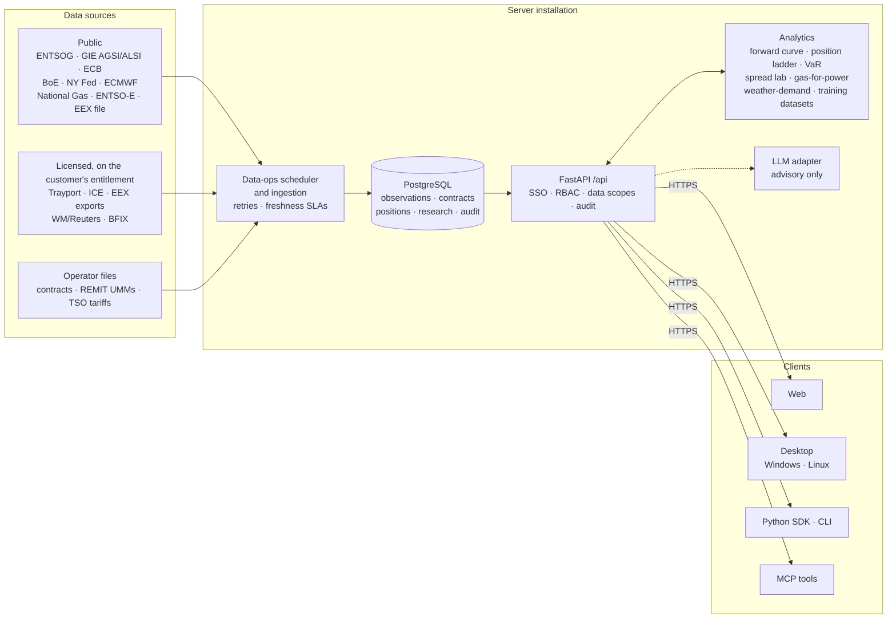

# Eurogas Nexus

**English** · [简体中文](README-CN.md)

[](https://github.com/AlexYuhuFeng/EurogasNexus/actions/workflows/ci.yml)
[](https://github.com/AlexYuhuFeng/EurogasNexus/actions/workflows/release.yml)
[](https://github.com/AlexYuhuFeng/EurogasNexus/releases)

**A decision-support workstation for European gas trading desks.** Traders, analysts,
risk, management and compliance staff read prices, fundamentals, positions and research
in one place, in desk units (p/th, EUR/MWh, MWh/d), on their own licensed market data.
It never enters orders, executes trades, nominates or settles.

Package version: `1.0.0-beta` · Channel: `beta` · Status: beta for customer acceptance,
not a production or GA release; 1.0.0 follows acceptance. The Python package reports it as
`1.0.0b1`.

## Start here

| You want to | Go to |
|---|---|
| Use the product in the browser or desktop client | [First sign-in](docs/user/QUICK_START.md), then the [guide for your role](docs/guides/README.md) |
| See it working on your own machine with demo data and call it from Python, in about five minutes | [Python SDK quickstart](docs/sdk/QUICKSTART.md) |
| Call the API from Python against your firm's server | [Python SDK](packages/python-sdk/README.md) and [Authentication](docs/sdk/AUTHENTICATION.md) |
| Install a server for your firm | [Deploy](#deploy) |
| Change the code | [Develop](#develop) |
| Find any other document | [Documentation index](docs/README.md) |

Implementation teams start with [Client onboarding](docs/guides/CLIENT_ONBOARDING.md);
support routes are in [Support and updates](docs/guides/SUPPORT_AND_UPDATES.md).

## What it does

| Area | Highlights |
|---|---|
| **Market** | Hub board and quote ladder (WD, DA, WE, BOM, months, quarters, seasons, Cal) for NBP, TTF, THE, PEG, ZTP, PSV; spreads to TTF; product strip; unit and FX converter; storage against EU targets; network map of flows and capacity |
| **Fundamentals** | ENTSOG flows and capacity, GIE storage and LNG, ECB/BoE/NY Fed rates, ECMWF temperature, GB demand, ENTSO-E power (load, wind, solar, gas generation, prices), gas-for-power (residual load, spark/dark spreads, fuel switch); REMIT outage messages |
| **Research** | Spread lab with declared-rule backtests; strategy design, frozen backtests, comparison and shadow runs; point-in-time training datasets over prices, power, storage, LNG and flows with lags, rolling features and walk-forward folds |
| **Portfolio and risk** | Position ladder (physical and financial by hub and month, hedge ratio), mark-to-market on the forward curve, indicative VaR, route economics, capacity billing, early-cash valuation with SONIA/€STR/SOFR |
| **Decisions** | Evidence-backed decision cases with four-eyes approval, alerts with optional LLM explanations, full audit trail |
| **Platform** | SSO (OIDC), RBAC with commercial data scopes, per-user preferences and organisation defaults, English and Chinese, light/dark, green-up or red-up P&L colours, keyboard-first navigation |
| **Programmatic access** | REST API under `/api`, [Python SDK](packages/python-sdk/README.md), `eurogas-nexus` command line, MCP tools |

**Boundary:** market and portfolio analysis leads to a recorded human review; execution,
nominations and settlement stay in the firm's operating systems. Licensed market prices use
the firm's entitled sources or approved imports; simulated observations are labelled as such.

## Who uses it

| Role | Primary work | Guide |
|---|---|---|
| Trader | Desk → Today, Prices; Deals → Opportunities, Contracts | [Trader](docs/guides/TRADER.md) |
| Analyst, quant | Research → Fundamentals, Spreads, Cargo & netback; Python SDK | [Analyst and quant](docs/guides/ANALYST_QUANT.md), [SDK examples](docs/sdk/EXAMPLES.md) |
| Risk, finance | Book → Limits & P&L | [Risk and finance](docs/guides/RISK_AND_FINANCE.md) |
| Management | Book → Position; Research → Reports | [Management](docs/guides/MANAGEMENT.md) |
| Legal, compliance | Deals → Review | [Legal and compliance](docs/guides/LEGAL_COMPLIANCE.md) |
| IT admin, data operator | Admin → Data Sources, Runtime, Access & Identity | [Administration and operations](docs/guides/ADMIN_AND_OPERATIONS.md) |
| Developer integrating another system | REST API, Python SDK | [SDK reference](docs/sdk/REFERENCE.md), [API conventions](docs/api/API_CONVENTIONS.md) |

## How data flows



Every source lands in PostgreSQL with its units, source reference and availability time.
Only the API reads the database; each row passes the caller's data scopes, and provider
credentials never leave the server. Analyses return provenance and warnings with their
numbers. Details: [Architecture](docs/architecture/ARCHITECTURE.md). Multi-office
deployment (UK, Canada, Singapore; separate China installation):
[Global deployment](docs/architecture/GLOBAL_DEPLOYMENT.md).

## Deploy

Two roles: a **server** (PostgreSQL, API, HTTPS gateway, ingestion workers, in Docker
Compose) and **clients** (Windows or Linux desktop installer, the browser, or the Python
SDK).

1. **Server.** Follow [Deployment roles](docs/deployment/DEPLOYMENT_ROLES-EN.md). Windows
   servers use `Deploy-EurogasNexus.ps1 -Role Server`; Linux servers use
   [deploy/runtime](deploy/runtime/README-EN.md). Configuration comes from
   `deploy/runtime/env.server.example` and is checked at start-up
   (`python scripts/ops/check_config.py --strict`). Two values are required before the
   server returns any data:
   - `RUNTIME_STORE_DATABASE_URL`, in the form
     `postgresql+pg8000://<user>:<password>@<host>:<port>/<database>` on a UTF-8
     database. A bare `postgresql://` URL fails because it selects a driver that is not
     installed ([Live PostgreSQL](docs/operations/LIVE_POSTGRESQL.md)).
   - `EUROGAS_NEXUS_PUBLIC_API_TOKEN`, the deployment token. Without it every route except
     `/api/health` answers `503 public_api_token_not_configured`. Give it to SDK, CLI and
     service users through your secret store.
2. **Sign-in.** Configure OIDC with your identity provider
   ([OIDC access token](docs/operations/OIDC_ACCESS_TOKEN.md)), then grant roles and data
   scopes ([Roles and responsibilities](docs/product/ROLES_AND_RESPONSIBILITIES.md)). Issue
   identity keys to SDK users and service accounts ([API keys](docs/operations/API_KEYS.md)).
3. **Data.** Add GIE and ENTSO-E keys, schedule the public sources, and connect or import
   your licensed prices ([Live price sources](docs/operations/LIVE_PRICE_SOURCES.md)).
4. **Clients.** Install the desktop client pointing at `https://<server>/api`, or open the
   web address. SDK users need the server origin (`https://<server>`, without `/api`), the
   deployment token and their identity key; see [Authentication](docs/sdk/AUTHENTICATION.md).
5. **Operate.** Backups and restore drills, retention, health and metrics
   ([docs/operations](docs/operations)).

## Develop

Requirements: Python 3.11+, Node.js 24, PostgreSQL 16 for the full path (SQLite is enough
for the API and the SDK), Rust only for desktop builds.

```bash
python3.11 -m venv .venv && source .venv/bin/activate
python -m pip install -e ".[dev]"

export RUNTIME_STORE_DATABASE_URL=postgresql+pg8000://<user>:<password>@127.0.0.1:5432/eurogas_nexus
export EUROGAS_NEXUS_PUBLIC_API_TOKEN=local-dev-token     # any value on your own machine
export EUROGAS_NEXUS_DEMO_MARKS=true
alembic upgrade head
python scripts/demo/seed_demo_desk.py                    # optional: the fictional demo desk
uvicorn apps.api.main:app --host 127.0.0.1 --port 8000

npm --prefix clients/web ci && npm --prefix clients/web run dev
```

Without PostgreSQL, follow the [Python SDK quickstart](docs/sdk/QUICKSTART.md), which runs
the API on a local SQLite file; `alembic upgrade head` does not run on SQLite. More in
[Local development](docs/operations/LOCAL_DEVELOPMENT.md).

Before pushing (install as `.git/hooks/pre-push`):

```bash
bash scripts/ci/pre_push_check.sh          # ruff check ., fast pytest, web tests
pytest -q tests                            # full suite
npm --prefix clients/web run build
python -c "from apps.api.main import app; print(len(app.openapi()['paths']))"
```

CI adds PostgreSQL integration, browser acceptance in English and Chinese with
accessibility checks, native desktop builds, SDK acceptance and licence/vulnerability
audits. See [Validation](docs/operations/VALIDATION.md),
[Release readiness](docs/release/RELEASE_READINESS.md) and
[CI and branch protection](docs/engineering/CI_AND_BRANCH_PROTECTION.md).

## Versions and releases

[Semantic Versioning](https://semver.org/): betas for customer acceptance are tagged
`vX.Y.Z-beta.N` and release candidates `vX.Y.Z-rc.N`, both published as GitHub
pre-releases; stable versions as `vX.Y.Z`. Preview builds of `main` are workflow artifacts,
not releases. What changed is in the [Changelog](CHANGELOG.md); how releases are cut is in
[Release channels](docs/release/RELEASE_CHANNELS.md); how the API may change between
releases is in the [API contract evolution policy](docs/architecture/API_CONTRACT_EVOLUTION_POLICY.md).

## Documentation map

- [Documentation index](docs/README.md), by task and by role · [中文文档索引](docs/README-CN.md)
- [Guides by role](docs/guides/README.md)
- Python SDK: [Quickstart](docs/sdk/QUICKSTART.md) · [Authentication](docs/sdk/AUTHENTICATION.md) ·
  [Examples](docs/sdk/EXAMPLES.md) · [Reference](docs/sdk/REFERENCE.md) ·
  [Troubleshooting](docs/sdk/TROUBLESHOOTING.md)
- [Architecture](docs/architecture/ARCHITECTURE.md) ·
  [Decisions](docs/architecture/ARCHITECTURE_DECISION_RECORD.md) ·
  [Project directory and ownership](PROJECT_DIRECTORY.md)
- [Data source terms](docs/legal/DATA_SOURCE_TERMS.md) ·
  [Dependency licences](docs/legal/DEPENDENCY_LICENSE_REVIEW.md) ·
  [Third-party notices](THIRD_PARTY_NOTICES.md)
- [Changelog](CHANGELOG.md) · [Documentation policy](docs/engineering/DOCUMENTATION_POLICY.md)

## Security and licence

Proprietary software, source-visible. Do not commit credentials, licensed vendor data,
customer contracts or deployment details. Report vulnerabilities as described in
[SECURITY.md](SECURITY.md); contribution rules are in [CONTRIBUTING.md](CONTRIBUTING.md);
licence terms in [LICENSE](LICENSE).
