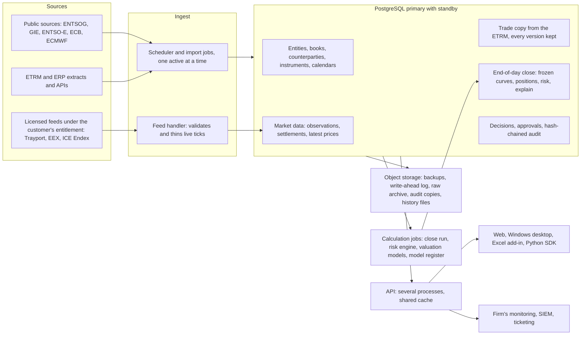
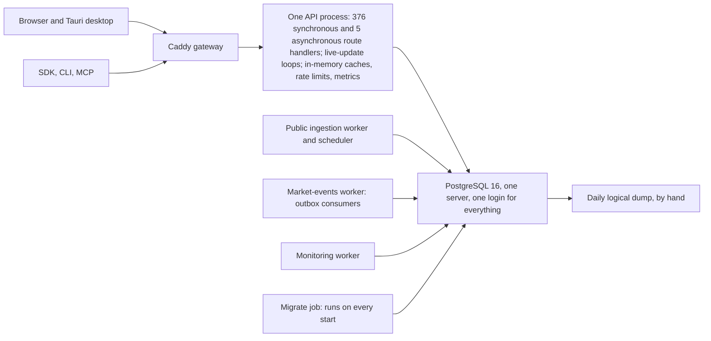
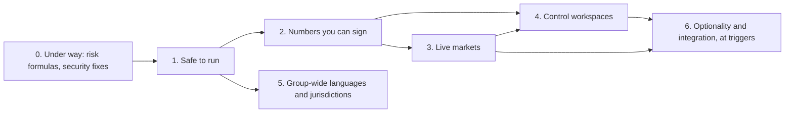

# Eurogas Nexus: architecture plan, version 3

Status: **proposal for the owner's decision, 2026-11-26.** Nothing in it is accepted until the
owner decides the questions in section 8. Sizes are estimates, given as ranges.

Inputs: the seven professional reviews of 2026-11-26
([professional-review-2026-11-26](../assessments/professional-review-2026-11-26/README.md)),
the backend audit of the same day
([BACKEND_AUDIT_2026-11-26.md](../assessments/BACKEND_AUDIT_2026-11-26.md)), the 39 accepted
decisions in [ARCHITECTURE_DECISION_RECORD.md](ARCHITECTURE_DECISION_RECORD.md), the capacity
study ([19_DATA_CAPACITY_AND_INFRASTRUCTURE.md](../engineering/Commercial-Intelligence-V3/19_DATA_CAPACITY_AND_INFRASTRUCTURE.md))
and a check of the reviews' structural claims against the code at commit `870da77`.

Draft decision records that this plan needs are in [decisions/](decisions/) with names starting
`DRAFT-`.

---

## 1. Summary

### What the product is for, and what it is not for

Eurogas Nexus is a second screen for a European gas trading desk, beside the trading screens
(Trayport, ICE, EEX) and the trading and risk system of record (the ETRM: Endur, Allegro,
Aligne and the like). It answers "what does this outage, flow, price move or cargo delay mean
for our book, and what can we do about it", and it keeps the evidence for the decision. It is
the master for fundamentals, the network and market context, decision records and the
analytics built on them, and it must make every number it shows reproducible and trustworthy
enough to act on. The ETRM stays the master for trades, counterparties and the official profit
and loss. Nexus never places orders, submits nominations, settles or books (AGENTS.md rule 8);
a person's job title or chosen work mode never grants authority (rule 7); calculations take
live and recorded inputs by default and say which inputs were typed by hand (rule 19); and no
simulated price can be read as a market price (rule 17).

### The six structural causes behind most of the findings

The seven reviews raise about 120 distinct findings. Most of them are symptoms of six causes.
Fixing a symptom without its cause would leave the next symptom in place.

| # | Root cause | What it explains (examples; appendix A has every finding) |
| --- | --- | --- |
| 1 | **Nothing is recorded as of a point in time.** Positions, values and risk are computed when a screen asks; trade imports overwrite and delete; price history is pruned after 30 to 90 days; models carry no version. | No end-of-day close, no profit and loss of record, past risk cannot be recomputed, no risk history, no back-testing of risk, no model validation evidence, the "close" behind the day's figure was a 10:20 tick, the slow Today screen (158 database statements). |
| 2 | **The commercial data model is thinner than the business.** A trade is a flat volume at one fixed price; there is no legal-entity record, no trader, no regulatory trade identifier; money is stored as approximate floating-point numbers; and British pounds are written into column names. | Index-priced deals shown as unhedged flat-price risk, credit lines "incomplete" exactly where exposure is largest, no reconciliation with the ETRM, no group consolidation, no per-entity regulator, two screens showing two different net positions, figures that cannot be reconciled to the cent. |
| 3 | **Market data stops at public sources and files.** Licensed real-time connectors exist only as descriptions; prices carry no clear identity of contract and price type, so risk runs on one blended price series per hub and live ticks mix with official settlements. | No live prices, no settlement-curve history, value-at-risk that mixes day-ahead and month-ahead prices and books contract rolls as price moves, curves built from quotes of different days, simulated prices raising "breach" alerts, people able to type in prices under an exchange's name. |
| 4 | **The runtime is built for one process on one machine.** Live updates query the database inside the web server's single event loop for every open connection; caches, rate limits and metrics live in one process's memory; recovery is a daily dump; migrations run whenever the stack starts; the application and the migration tool share one all-powerful database login. | Demo pages taking 4 to 6 seconds and failing with 502 errors under a handful of users, a recovery point of 24 hours, no standby, metrics no monitoring tool can read, a scheduler that would double-ingest if run twice, audit rows the application itself can delete. |
| 5 | **Control depends on each code path remembering it.** Book separation is opt-in per query and off by default; the route registry ignores the HTTP method; one "reviewer" role serves risk, compliance and the head of desk; an administrator can switch the four-eyes rule off; a shared static token acts as anyone. | Security findings H1 to H7 and most mediums, compliance unable to read the audit trail, the head of desk able to approve his own desk's marks and credit lines, no segregation of duties a control function would sign. |
| 6 | **Breadth has outrun focus and continuity.** Two languages are written into code, types and tables; some calculations exist twice; research features sit beside the desk tools at the same rank; alerts fire on simulated data; one human maintains about 255,000 lines of AI-written backend code. | Each new language costs an engineering release, two LNG workflows and two cargo-economics engines, a "backtest" that is not one, 65 open alerts on a trader's strip, cluttered trader pages, procurement stopping at continuity (no escrow, no second maintainer). |

### The target architecture in one picture

In ten lines:

1. One PostgreSQL database stays the source of truth, now with a hot standby, a continuous
   backup to object storage and recovery to any minute.
2. Trades are a versioned copy of the ETRM's trades: index and formula prices, trader, legal
   entity and regulatory identifier, and every amendment and cancellation kept.
3. Money, prices and contract quantities are exact decimals with an explicit currency; each
   legal entity has its own reporting currency, regulators and calendar.
4. An end-of-day close freezes the official curve, positions, values and risk per business
   date, with the inputs, model versions and code that produced them, so any past figure can be
   recomputed exactly.
5. Live prices from licensed feeds enter through one separate feed-handler process that checks
   and thins ticks; screens see live prices, records use official settlements, and the two
   never mix.
6. Heavy and official calculations run as recorded jobs on a numerical library stack; screens
   read their stored results and add a live overlay; every model has a version and an owner.
7. The API runs as several processes behind the firm's load balancer, sharing a small cache;
   live updates come from one poller per process, not one per browser tab.
8. Access is enforced by structure: default-deny book and entity scopes in the data layer,
   separate roles for risk, credit, compliance, product control and the desk head, and an audit
   trail the application cannot rewrite.
9. Every sentence the server writes is a message code with parameters; languages, plural rules
   and a customer's own terms are data, so a new language is a translation file, not a release.
10. Clients stay React on the web and in a Windows desktop shell, with an Excel add-in and a
    Python SDK on the same API; nothing new is added that a measured need does not call for.

### What to stop or remove

- The strategy laboratory's "backtest", strategy tracks and the shadow runtime: its profit is
  known at the moment of decision, so it measures nothing (quant review 3.4). The spread
  laboratory stays as the research back-test.
- The second LNG cargo-economics engine (the research copy) and the second LNG workspace: one
  engine, one LNG workspace.
- Text in two fixed languages inside code, types and tables (`_zh_cn` columns, `T(en, zh)`
  pairs), and the bilingual AI summary written for every alert.
- Deleting price and observation history after 30 to 90 days; storing the same raw page
  168 times.
- Alerts and "breach" banners computed on simulated prices; the credit banner and nomination
  status pickers on the trader's landing page.
- Running database migrations automatically whenever the stack starts.
- The Linux desktop build as a supported product (Linux users use the browser).
- Further investment in the optional TimescaleDB extension (it stays as built, off).
- About two-thirds of the 437 documentation files, moved to an archive: programme packs and
  historical logs, leaving one current architecture, one decision record and the runbooks.

### Phases

| Phase | What a user sees at the end | Size (engineer-weeks, estimate) | Months (indicative) |
| --- | --- | --- | --- |
| 0. Under way | Risk formulas corrected; security findings H1 to H7 closed | already staffed | now |
| 1. Safe to run | 50 users with several tabs get sub-second pages; data recoverable to within 5 minutes; compliance reads the audit; risk, compliance and desk head are separate roles; redundant features gone | 22 to 36 | 0 to 4 |
| 2. Numbers you can sign | Yesterday's close is frozen and recomputes exactly; trades show their versions; positions reconcile to the ETRM; money in exact decimals per entity currency | 25 to 42 | 3 to 8 |
| 3. Live markets | Licensed prices live on the ladder within a second, settlement history and day-on-day changes, five years of fundamentals history with weather, prices in Excel | 19 to 32 | 6 to 10 |
| 4. A home for each control function | Risk, product control, credit, compliance and scheduling each have a workspace for their daily job: risk by tenor, stress, limits, profit and loss explained, surveillance queue | 28 to 42 | 8 to 14 |
| 5. Group-wide | German (then others) added as a translation drop; contracts read in German, French, Italian, Spanish; alerts routed by desk, office and shift | 16 to 25 | 6 to 12, in parallel |
| 6. Optionality and deeper integration | Storage, swing and capacity valuation; ETRM adapters; global LNG diversion | 23 to 40 | from month 12, at named triggers |

Phases 1 to 5 add up to about 110 to 177 engineer-weeks: two human engineers (with AI
assistance) through phase 2 and three from phase 3, or about 14 to 20 months.

### Hardware

- **Pilot** (one desk, up to 30 users, public data, end-of-day files, ETRM extracts): one
  application server (8 cores, 32 GB), two database servers as primary and standby (8 to 16
  cores, 64 to 128 GB, mirrored NVMe disks), 2 to 5 TB of object storage. Roughly 600 to
  900 EUR a month if rented; 2 to 4 days a month of operations.
- **Production** (several desks, 50 to 150 users, one licensed live feed): two application
  servers, two job servers, a database primary, standby and read replica, a feed-handler server
  in the market-data network zone, 10 to 20 TB of object storage with write-once retention,
  plus smaller test and training copies. Roughly 2,500 to 4,000 EUR a month if rented; about
  half to one full-time operations person.
- **Not worth buying:** Kafka, Kubernetes or a service mesh, kdb+, Oracle, a separate
  time-series database before the measured trigger, a GPU cluster for risk, a SAN for the
  database, a commercial monitoring suite, a data lake platform.

### Decisions the owner must make (section 8 has the detail)

1. Confirm that the ETRM is master for trades, counterparties and the official profit and loss.
2. Decide whether Nexus's risk figures may become a firm's official risk after model
   validation (recommended: build for it, decide per customer).
3. Choose the first licensed data: end-of-day exchange settlements by file first, then one
   live feed (recommended: Trayport, unless the pilot customer runs another platform).
4. Choose the AI posture: no default provider, customer's EU-hosted endpoint by default, own
   hardware only on demand.
5. Choose the languages after English and Chinese (recommended: German first).
6. Arrange continuity: a second human maintainer and source-code escrow (recommended: both,
   the maintainer before phase 2).
7. Approve the removals in section 5.
8. Choose the operating model: customer-hosted (recommended) or run by you as a service.
9. Approve the pilot and production hardware.
10. Answer the power question (recommended: no power-trading features in the next 12 months).
11. Commission an external penetration test at the end of phase 1.
12. Require human review of every change to the main branch in security, data-model and
    calculation code.

---

## 2. The current architecture, as it actually is

### 2.1 Shape

The runtime is a single Docker Compose stack on one host: a gateway, one API container running
one uvicorn process, three workers, a one-shot migration job, a reference-data seed and
PostgreSQL 16 (`deploy/runtime/compose.yaml`). The backend is Python 3.13 with FastAPI and
synchronous SQLAlchemy over the pure-Python `pg8000` driver. Clients are a React 19 and
TypeScript web application, the same application in a Tauri 2 desktop shell, a Python SDK,
a command line and an MCP tool server (disabled in customer profiles).

Size at `870da77`: about 255,000 lines of backend Python, 100,000 lines of web TypeScript,
190,000 lines of tests, 94 database migrations, about 165 tables, 437 Markdown documents
(about 720,000 words) and 39 accepted architecture decisions. 878 commits are by one AI agent,
65 by another and 3 by the owner.

### 2.2 What was checked, and where the reviews are right, outdated or wrong

| Claim (review) | Checked in code | Verdict |
| --- | --- | --- |
| One API process (technology, operations) | `deploy/runtime/Dockerfile.api` starts uvicorn with no worker count; one `api` service in compose | Right |
| Live updates block the event loop (technology) | `api/routes/public/streaming.py` lines 92 to 164: each open stream opens a database session and runs synchronous queries inside an `async` generator every poll interval | Right |
| Almost every route handler is synchronous (technology: 356 of 361) | 376 synchronous, 5 asynchronous today | Right; numbers moved |
| Pure-Python database driver (technology) | `pg8000` in `pyproject.toml` and the lock | Right; but the suggested replacement, psycopg 3, is LGPL and the dependency gate refuses LGPL (`scripts/ci/audit_dependencies.py`) |
| Money in floating point (middle office: 224 Float against 7 Numeric) | About 206 `Float` columns against about 16 exact-decimal ones (decimal is used in opportunities, commercial assumptions and LNG positions) | Right in substance |
| British pounds pinned in the data model (front office, quant) | `domain/market_intelligence/normalized_view.py:49 TARGET_CURRENCY = "GBP"`; `_gbp` columns in six model files, mostly strategy, shadow and back-test tables | Right; removing the strategy laboratory removes most of it |
| Cancelled trades deleted, re-sent trades replaced (middle office, technology) | `ingestion/etrm_trades.py` docstring and parser; columns have no trader, legal entity, index or identifier | Right |
| Legal entity is free text (multinational) | `db/models/books.py: legal_entity String(64)` | Right |
| Retention deletes quotes after 30 days and observations after 90 (technology, operations) | `application/retention.py` | Right (it is a manual script; nobody schedules it yet) |
| Licensed connectors are manifests only (technology, front office) | `implemented=False` for Trayport, EEX, ICE, Platts, Kpler, ICIS and Argus | Right |
| Metrics cannot be scraped (technology, operations) | `/api/runtime/metrics` returns Prometheus text inside a JSON envelope behind a session | Right |
| No scheduler lock (technology) | No advisory lock in `scripts/ops/run_dataops_scheduler.py` | Right |
| Migrations run on every start (operations) | `migrate` service runs `alembic upgrade head` | Right; it also contradicts accepted Decision 2A ("migration must not run during startup") |
| One database login for migration and runtime (technology, security) | One `RUNTIME_STORE_DATABASE_URL` | Right; being remediated |
| Book isolation off by default (security H1) | `security/portfolio_scope.py`: opt-in environment flag | Right; being remediated |
| Administrator reads decision cases (security H2) | Partly fixed on the tree after the review (commit `cf66994`); the rest is being remediated | Partly outdated |
| Six roles, one reviewer role for risk, compliance and management (middle office) | `security/identity.py`: VIEWER, SCHEDULER, ANALYST, REVIEWER, OPERATOR, ADMIN | Right |
| Audit readable only by administrators (middle office) | `security/permissions.py:86` | Right |
| Default AI endpoint outside the EU (front office, technology, security) | `llm/provider.py: DEFAULT_BASE_URL = "https://api.deepseek.com"`; external models are hard-off in release | Right |
| No numerical libraries at run time (technology, quant) | No NumPy or SciPy in `requirements.lock`; `pyarrow` only | Right |
| Languages written into code (multinational) | `SUPPORTED_LANGUAGES = ("en", "zh-CN")`; `startsWith("zh")` in 26 client files; `en`/`zh-CN` literal types in 8 validators; `_zh_cn` columns; about 640 `T(` calls in report and brief writers | Right; counts differ slightly |
| "No TimescaleDB code exists" (operations) | Optional TimescaleDB support was merged: Decision 39, migration `0093_timescale_optional`, off by default | **Outdated** |
| "No volatility or Black-76 code" (front office, quant) | Gas option settlements, Black-76 implied volatility and smile metrics were merged after the review (migration `0094_option_settlements`, `domain/market/options.py`) | **Outdated**: market volatility is now read; the firm's own optionality (storage, swing, capacity) is still not valued |
| One review notes a single cargo-economics engine | Two exist: `domain/lng/cargo_economics.py` (743 lines, desk) and `domain/research/lng_cargo_economics.py` (1,729 lines, research sandbox); also small research copies of route cost, netback and units | **New finding**: duplication |
| "Nexus should carry trade capture fit for risk" (middle office) | Decision 11 forbids trade capture and ETRM replacement | **Resolved** as a versioned *copy* of the ETRM's trades, not capture (section 3.1) |

### 2.3 What is good and must be kept

These are strengths a buyer's committee named, and the plan builds on them rather than
replacing them:

- **One source of truth.** One PostgreSQL database, one migration chain, clients only through
  the API (Decisions 1 to 4). This is the right shape; the plan adds resilience, not stores.
- **Provenance and refusal.** Every observation carries its source, unit and availability time;
  missing inputs are refused or counted, never filled with zero; simulated rows are marked
  through one predicate; hand-entered inputs are stated on the result.
- **The foundations for units, currency and time** (Decision 27): unit dimensions, explicit
  exchange rates, the daylight-saving-aware gas day, native units first.
- **The transactional outbox** (Decision 28): events written in the same transaction as the data,
  delivered with retries and dead letters, no broker.
- **Licensed-data governance**: the licence register with display and non-display use, seat
  counting, per-request usage metering, fail-closed file exports (Decisions 31 and 34).
- **Four-eyes changes** in one table with before-and-after figures (Decision 32).
- **Versioned tariffs and capacity bookings** (Decisions 34 and 38), and the source-precedence
  resolver.
- **The calculation building blocks** the quant review verified: unit conversion, gas day,
  curve bootstrap weighted by hours, tariff conversion, the LNG chain, the min-cost circulation.
- **The desk-specific workflows** reviewers would adopt: the outage-to-book map, the gas-day
  trade, confirmation, nomination and TSO reconciliation, the credit and mandate board, the
  LNG disruption options.
- **Supply-chain hygiene**: hash-pinned locks, SHA-pinned actions and images, SBOM, build
  attestations, a fail-closed licence audit, signed releases.
- **The seeds of reproducibility**: frozen valuation snapshots with replay
  (`application/valuation_snapshot.py: freeze_snapshot`), a calculation fingerprint
  (`application/calculation_manifest.py`), revisions with `as_of` reads, a job runner with
  progress (`application/background_jobs.py`).

---

## 3. Target architecture, layer by layer

Each layer states: today, the problem, the target, the alternatives considered, why this one,
and the path to it without a big-bang rewrite.

### 3.0 Principles that apply to every layer

1. **One master per fact.** Appendix C names, for every kind of data, the system that owns it.
   Nexus copies what it does not own and never edits the copy.
2. **What is shown for action is recorded.** A figure that someone may sign, report or rely on
   later is produced by a recorded run (inputs, model version, code version), not recomputed
   on read. Live screens may add a live overlay, labelled as such.
3. **One engine per calculation.** A research tool calls the desk engine; it does not keep its
   own copy.
4. **Control is enforced by structure.** Scopes, roles and audit immutability are enforced where
   a forgotten line of code cannot bypass them (database grants, row security, one data-access
   layer), not only in each handler.
5. **The server writes codes, not sentences.** Text is rendered from catalogues in the reader's
   language.
6. **No component without a measured need or a control requirement.** Rules 4 to 6 of
   AGENTS.md stand. A new component is proposed only where the reviews measured the need
   (the demo latency) or a control demands it (recovery, audit).

### 3.1 Data model

**Today.** Instances live in PostgreSQL, reference data in the ontology package (Decision 25).
A trade is one row per (system, trade id) with a fixed price and a flat daily volume;
re-imports replace it and cancellations delete it. Books carry a free-text legal entity and a
base currency. Positions, values and risk are computed on read. Money is mostly `Float`; some
names carry `_gbp`. One price series per hub feeds risk.

**Problem.** Index-priced deals cannot be decomposed into price exposures; yesterday cannot be
reproduced; entities cannot be consolidated or regulated separately; reconciliation to the cent
is impossible; the "hub series" mixes contracts and price types (root causes 1 to 3).

**Target.**

1. **Entities and organisation as first-class reference data.** `legal_entities` (name, LEI,
   ACER code, functional currency, jurisdiction, regulators, data-residency zone, holiday
   calendar), `desks` and `books` under an entity, `traders` linked to identities,
   `counterparties` with parent and guarantor, and their master agreements and netting sets
   (EFET, ISDA, CSA terms). Books reference an entity by key, not text. Holiday calendars per
   exchange and market (`calendars`, `calendar_days`).
2. **Instruments and prices with identity.** An instrument is hub (or index) times product
   (day, weekend, balance of month, month, quarter, season, year) times delivery period times
   venue. A price has a type: bid, ask, mid, last, settlement, firm mark, broker assessment.
   Price indices (TTF month-ahead, NBP day-ahead, Brent 6-0-1) and formulas are reference data
   that deals point to.
3. **A versioned copy of the ETRM's trades** (`deals`, `deal_versions`, `deal_legs`). Every
   version is kept: amendment time in the ETRM (when it became true) and the time Nexus
   recorded it. Cancelled is a state, never a deletion. A leg carries fixed or index or formula
   pricing (index, averaging period, differential, currency, unit), a quantity shape (per gas
   day, and per hour where needed), and optional volume terms (minimum and maximum daily
   quantity, make-up, carry-forward). The version carries the trader, the legal entity, the
   book, the counterparty and the unique transaction identifier (UTI). This is a copy, not
   trade capture: Decision 11 stands.
4. **Exact money.** Money, prices and contractual quantities are stored as exact decimals
   (`Numeric(28, 10)` for amounts and prices, `Numeric(20, 6)` for energy) with an explicit ISO
   currency and unit beside them. No column name contains a currency. Physical measurements
   (flows, stocks) and statistical outputs stay floating point; they are measurements, not
   money. Calculations may use floating point internally (NumPy does), but stored results of
   record are rounded to declared precision and stored as decimals.
5. **One exposure model.** One function turns deal legs into two views every screen reads:
   *physical volume* by gas day and delivery point, and *price exposure* by risk factor (index
   or hub, times tenor). An index-priced purchase is volume with basis exposure, not flat-price
   risk. Today's two different net positions disappear because there is one definition.
6. **Time of record.** "Two times" (bitemporal) storage only where a past figure depends on
   what was known then: deal versions, valuation-relevant reference data (limits, mandates,
   firm marks, entity and counterparty terms), and settlement prices (which publishers revise).
   Observations already carry revisions and `as_of` reads; they are not changed.
7. **End-of-day close** (`close_runs` and their results). Per business date and entity, a run
   freezes the official curve, the trade versions it used, positions, values, risk, credit and
   limit use, with a manifest of input hashes, model versions and the code fingerprint. A
   frozen run is never edited; a rerun supersedes it with a reason. Product control can attest
   that the frozen figures match the ETRM's official ones; that attestation is a record in
   Nexus, not the official sign-off, which stays in the ETRM (Decision 11).

**Alternatives considered.** (a) A full bitemporal database for every table: correct but
doubles the cost of every write and read for data that does not need it. (b) Event sourcing
(rebuild state from an event log): elegant, but a rewrite of every reader and a second model
of truth beside the outbox. (c) Importing the ETRM's positions and risk only, without trades:
cheap, but then Nexus cannot explain, stress or decompose anything. (d) Making Nexus capture
trades: rejected by Decision 11 and by the positioning.

**Why this one.** It records exactly what a controller asks about ("what did we report at the
close on 14 November, and why does it differ?"), reuses the existing snapshot, fingerprint
and revision foundations, and changes no reader that does not need it.

**Migration path.** New tables are added beside the old (expand); the ETRM import contract
gains a version 2 that writes deal versions while version 1 keeps working; readers move one by
one; old columns are dropped only after a release with both (contract). Money columns move table
family by table family (risk, credit and limits; profit and loss and invoices; trades and
curves; contracts), each with a dual-write release and a reconciliation test that old and new
agree. The strategy-laboratory tables are removed, not migrated. Draft decisions:
[DRAFT-entities-money-and-currency.md](decisions/DRAFT-entities-money-and-currency.md),
[DRAFT-versioned-deals-and-end-of-day-close.md](decisions/DRAFT-versioned-deals-and-end-of-day-close.md).

### 3.2 Storage

**Today.** PostgreSQL 16 on one server; a logical dump taken by hand (recovery point 24 hours);
no standby; raw source pages archived in the database, about 91 % of growth; manual retention
that deletes 30- and 90-day-old prices and observations; optional TimescaleDB on three tables,
off.

**Problem.** A day of decisions, approvals and audit can be lost; history, which is the asset,
is deleted by the only retention tool; the database grows mainly with duplicate pages
(root causes 1 and 4).

**Target.**

- **Primary and hot standby** with streaming replication and automatic or one-command failover
  (Patroni, MIT licence, or the firm's managed PostgreSQL with high availability).
- **Continuous backup** with pgBackRest (MIT): the write-ahead log (WAL, the database's change
  journal) shipped continuously to object storage, weekly full and daily differential backups,
  recovery to any minute (point-in-time recovery). Recovery point 5 minutes or better; recovery
  time under 1 hour, measured on a realistic store each quarter.
- **Object storage** (any S3-compatible store: the firm's own, a cloud bucket or a provider; not
  MinIO, whose AGPL licence conflicts with rule 18 if shipped) with write-once retention for
  backups and audit copies. It also holds the raw page archive (each distinct page once,
  compressed, with its digest) and, later, cold history as Parquet files.
- **Retention by data class**, configurable upward only, scheduled inside the product, archive
  before delete: settlements, curves, closes, trades and audit kept at least 7 years (REMIT,
  MiFID II, EMIR record keeping); observations kept; intraday quotes thinned to one-minute bars
  after 90 days; raw pages moved to object storage after 4 weeks.
- **A read replica** for Excel, reports and research when the primary is busy (trigger: primary
  CPU above 60 % sustained, or desk reads miss their budget during research).
- **Monthly partitions** on the largest observation tables before the five-year backfill, or
  at 50 million rows (Decision 24 stands).
- **TimescaleDB stays as built, off.** If licensed ticks are later kept for months, turn it on
  for the tick tables first (it is already built and adds no new server); a separate tick store
  (ClickHouse) only if that is measured to be insufficient.

**Alternatives considered.** Nightly dumps only (does not meet a trading firm's control
expectations); managed cloud database only (fine where the customer is on that cloud, so
supported, but not required); ClickHouse now (no licensed ticks yet); a data lake (export
Parquet to the firm's lake instead).

**Why.** Recovery is a control requirement, not a performance optimisation, so it needs no
further measured need; the archive growth is measured (about 107 MB a day today, 3.2 GB a day
with hourly flows).

**Path.** Standby and backup first (no application change); then the archive deduplication and
offload; then retention by class; partitions at their trigger. Draft decision:
[DRAFT-standby-backup-object-storage-retention.md](decisions/DRAFT-standby-backup-object-storage-retention.md).

### 3.3 Market-data ingestion

**Today.** A scheduler runs public-source scripts; licensed prices arrive as CSV exports of a
trader's own screen or through `POST /api/market/ticks`, which any operator can call under an
exchange's name; tick ingestion runs a duplicate check, one "previous price" query per
instrument and the opportunity evaluation in the same transaction, and refuses a whole batch
for one implausible tick; one price resolver serves both live screens and valuation.

**Problem.** No live licensed prices; no settlement history; a write path that will not take a
real feed; price integrity depends on who can call an endpoint (root causes 3 and 5).

**Target.** Three paths, one store:

1. **Scheduled public sources** as today, with one active scheduler (a database advisory lock
   and a heartbeat), one shared retry helper, and freshness alerts before the gas-day deadlines.
2. **Versioned file and API imports** for the ETRM, ERP, end-of-day settlements and licensed
   vendor exports. Exchange settlements (EEX, ICE Endex) under the customer's licence are the
   *first* licensed data, because the close needs them and their non-display licence is the
   cheapest. They fill a settlement table per instrument, trade date and price type, with
   revisions.
3. **A feed-handler process** for licensed live prices, in the market-data network zone. It
   subscribes through a vendor adapter (first: Trayport, or the firm's market-data platform if
   the pilot customer runs one), keeps the last value per instrument in memory, checks each
   tick (and drops a bad tick, not the batch), writes one-second snapshots to a latest-price
   table and one-minute bars to history, and wakes listeners. It authenticates as a service
   identity; licensed exchange families are refused from people. Opportunity evaluation moves
   to an outbox consumer, off the write path.

**Two price sets, never mixed:** *live* (the freshest valid price, for screens) and *official*
(the settlement, or the firm's policy snapshot at a stated time, for the close). The resolver
says which set a figure used.

**Entitlements and usage** stay as built and gain a monthly vendor report per user, office,
family and display or non-display use, seat history, licence-expiry alerts, and a "derived
from licensed data" tag on spreads, curves and netbacks built from licensed prices.

**Alternatives considered.** Calling vendor APIs from the API process (would block it and mix
concerns); a message broker for ticks (not needed: thinned updates are a few per second per
instrument); storing every tick (licence and volume cost without a use).

**Path.** Settlement import in phase 2; feed handler in phase 3; the direct tick endpoint closed
to people as part of the security remediation. Draft decision:
[DRAFT-feed-handler.md](decisions/DRAFT-feed-handler.md).

### 3.4 Calculation and model layer

**Today.** Calculations are pure functions in `domain/` (good) called on the request path;
heavy and light alike. Value-at-risk (VaR: the loss not exceeded on 95 of 100 days) is a
proxy on one series per hub; there is no stress testing, no profit-and-loss explanation, no
independent price verification, no model register. Solvers are hand-written in pure Python
(a dynamic programme for storage, Bellman-Ford for networks). The risk formula errors are being
fixed now.

**Problem.** Official numbers are not recorded with their model version; heavy calculations
compete with screens; a model validator cannot check a hand-written solver against a standard
one; optionality cannot be valued without a numerical stack (root causes 1 and 3).

**Target.**

- **Two kinds of calculation.** *Interactive* calculations (what-ifs, netbacks, route costs)
  stay on the request path, with bounded inputs. *Recorded* calculations (the close, risk runs,
  stress, profit-and-loss explanation, storage valuation) run as jobs in the existing job
  runner and store their results with a manifest. Screens read stored results.
- **A risk engine** on the instrument model: return series per contract or constant maturity
  (never splicing day-ahead into month-ahead, rolls removed), VaR by tenor bucket with
  correlation, expected shortfall (ES: the average loss beyond VaR), stressed VaR, named stress
  scenarios (Norwegian outage, cold snap, 2021-22 replay, curve twist), a limit hierarchy (firm,
  entity, desk, book, trader), a breach lifecycle and stored history; VaR back-testing against
  hypothetical profit and loss with exception counts.
- **Profit and loss explained** against the ETRM's imported official figure: new trades, price
  move, volume change, time, exchange rates, carry. Nexus explains; the ETRM states.
- **Independent price verification (IPV)**: desk marks against settlements and broker quotes per
  tenor, with tolerances and reserves.
- **A model register**: every engine (VaR, mark-to-market, curve, credit, cargo, storage) with
  owner, tier, version, approval state, validation date, limitations; every stored result
  references the model version.
- **A numerical stack**: NumPy and SciPy (BSD), HiGHS through `highspy` (MIT) for linear and
  mixed-integer programmes, Numba (BSD) where a loop needs compiling. The hand-written solvers
  become test oracles. The LNG disruption engine stays enumerative (Decision 36), because each
  option must be explainable line by line.
- **Optionality later** (phase 6): storage (rolling intrinsic, then least-squares Monte Carlo
  with ratchets), swing and take-or-pay, capacity as a spread option, cargo diversion, built on
  the market volatility data that now exists.

**Alternatives considered.** Import the ETRM's VaR only (many ETRMs' risk is weak, and nothing
could be explained or stressed here); a commercial risk engine (licence cost and integration
work out of proportion for a decision-support tool); a separate calculation service (not
needed: the job runner and a second job server suffice).

**Path.** Phase 2 adds the numerical stack, the close run and exposure model; phase 4 the risk
engine, explanation, IPV and model register; phase 6 optionality. Draft decision:
[DRAFT-numerical-stack.md](decisions/DRAFT-numerical-stack.md).

### 3.5 API

**Today.** REST and JSON under `/api`, server-sent events for push; 384 routes; ten
hand-written response helpers; four pagination styles; OpenAPI hidden in release; no version
handshake; the web client's types are hand-written in one 8,459-line file.

**Problem.** Integrations outlive releases; a newer client polled routes an older server did
not have and got errors on every page; hand-written types drift (root cause 6).

**Target.** Keep REST and server-sent events under `/api` (Decision 3). One envelope builder,
one cursor pagination, notices as codes with parameters. The OpenAPI document is generated
and shipped as a release artefact and served to authenticated integration identities. Client
types and the SDK are generated from it. Breaking changes get a new path version for that
resource (`/api/v2/...`) with at least two releases of overlap; additive change needs nothing.
A version handshake: the client reads the server's route census and shows "not on this server"
instead of polling a missing route. Integrations use service identities, never a shared token.
A read-only pre-deal credit check is offered to the ETRM.

**Alternatives.** GraphQL (rare in trading back ends, harder to entitle field by field); gRPC
(only between the feed handler and the store, if ever); a global `/api/v1` prefix (churns every
path for no gain).

**Path.** Incremental, as the backend audit's structural plan already sets out (envelope first,
then pagination, then generated types).

### 3.6 Eventing and streaming

**Today.** The transactional outbox and change feed are sound. Live updates poll the database
per connection, synchronously, inside the event loop.

**Target.** Keep the outbox (Decision 28). Each API process runs one background poller per
topic, woken by PostgreSQL `LISTEN/NOTIFY`, which reads changes once and fans them out in
memory to that process's open streams after the entitlement filter. Database work runs off the
event loop. A cap on streams per person. Kafka only at its trigger: three or more outside
consumers needing replay, or a firm's mandate to publish on its own bus, in which case Nexus
publishes to the firm's broker rather than running one.

**Path.** Part of phase 1's serving fix. Draft decision:
[DRAFT-multi-process-api-and-shared-cache.md](decisions/DRAFT-multi-process-api-and-shared-cache.md).

### 3.7 Clients and information architecture

**Today.** React web application with four modes (Desk, Deals, Book, Research) and many tasks;
the same build in a Tauri desktop for Windows and Linux; a Python SDK of module functions; a
Power Query how-to for Excel. Reviewers found duplicate homes (two LNG workflows; ladder and hub
board), raw codes and evidence dumps on trader pages, 65 open alerts on the trader's strip and
no home for risk, product control, compliance or the scheduler.

**Target.**

- **Role workspaces composed from shared components**; a capability does not earn a page
  (rule 9) and a role never earns authority (rule 7):

| Role | Home | Other workspaces |
| --- | --- | --- |
| Trader | Prices: ladder, spread strip, my delta by tenor | Gas day (physical position, deadlines); Network map; LNG (fleet, cargo plan, netback, hedge) |
| Originator / structurer | Deal pricer (phase 6) | Contracts; Review |
| Analyst | Fundamentals (with weather and history) | Spread laboratory; Reports |
| Market risk | End of day: close status, VaR and ES with history, limits, explain, attestation | Credit; Model register |
| Product control | Close and IPV | Profit and loss explained |
| Compliance | Surveillance queue | Audit; inside-information register |
| Scheduler | Gas day: cut-offs and breaks, imbalance, allocations | Network map |
| Desk head | Management pack | Review |
| Operations | Service: health, sources, incidents, user notices | Licences; Languages |

- **The search bar covers every instrument, hub, tenor, spread, asset, outage, counterparty,
  contract and workspace**, in each shipped language; it never answers "no matching commands"
  for a hub and tenor.
- **Alerts**: none from simulated data; credit and limit breaches routed to risk, not to the
  trader's strip; acknowledged before they repeat; routed by desk, office and shift.
- **Web stays the primary client.** The **Windows desktop stays on Tauri** (Decision 21), with
  an MSI package, a narrower content policy and mandatory signing. The Linux desktop is no
  longer a supported product.
- **Excel add-in** (Excel-DNA, zlib licence): live price, freshness and alerts as RTD (real-time
  data) cells, and functions for curve strips, route costs, netbacks and balance lines, with
  single sign-on. It reuses the API; no new back end.
- **SDK** as a client object with session authentication, retry and DataFrame output, the
  analyst's documented path to a notebook.
- **FDC3** (the finance industry's standard for passing context such as an instrument between
  desktop applications) when a customer runs an interop desktop.

Draft decision: [DRAFT-client-surfaces.md](decisions/DRAFT-client-surfaces.md).

### 3.8 Identity and security

**Today.** Strong hygiene (OIDC with PKCE, hashed sessions, central route registry, signed
supply chain). Weak authorisation and segregation (findings H1 to H7 and M1 to M10, now being
remediated).

**Target, beyond the remediation in progress.**

- **Role model with segregation of duties.** Roles: VIEWER, TRADER, ANALYST, SCHEDULER,
  DESK_HEAD, MARKET_RISK, CREDIT_RISK, PRODUCT_CONTROL, COMPLIANCE, DATA_OPERATOR,
  PLATFORM_ADMIN, IDENTITY_ADMIN. Rules: front office (trader, desk head) never approves marks,
  limits or credit; compliance reads audit and surveillance and approves nothing commercial;
  the platform administrator reads no commercial data; grants of roles and scopes need a second
  identity administrator and the business owner; the creator of an identity cannot approve its
  proposals; changing the four-eyes setting is itself four-eyed.
- **Scopes enforced twice.** Book and entity scope default-deny in the one data-access layer
  (being built now), then PostgreSQL row-level security (RLS: the database itself filters rows
  by the caller's scope) on book-scoped tables as a second layer once database roles are split.
- **Database roles**: migration owner, application (no DDL, insert-only on audit), read-only
  reporting, audit reader.
- **Audit**: hash-chained rows, a signed daily digest, a write-once export to object storage and
  a stream to the firm's SIEM (security information and event management system), at least five
  years' retention, pruning only under four eyes. Compliance reads it.
- **Sign-in**: single sign-on only in release; local accounts only as break-glass with a hardware
  key; idle timeout 30 minutes by default; SCIM or scheduled directory reconciliation for
  leavers at the first customer above about 50 users.
- **Secrets** from the firm's vault or key service (file mounts), separate keys per purpose,
  rotation without downtime.
- **AI egress**: no default provider; an allow-list of endpoints per installation and per legal
  entity; private endpoints allowed in release; prompts label untrusted text; a written data
  classification for market-abuse and REMIT purposes before any book data reaches a model.

Draft decision: [DRAFT-role-model-and-segregation-of-duties.md](decisions/DRAFT-role-model-and-segregation-of-duties.md).

### 3.9 Languages and locales

**Today.** English and Chinese, carefully, but written into code: literal types, `startsWith("zh")`
branches, `T(en, zh)` pairs, `_zh_cn` columns, a hand-written grammar per language. Contract
intake, news tagging and the search grammar are English-only.

**Target.** A language is a row of data plus translation files:

- **One locale registry** (code, native name, fallback chain, status *preview* or *shipping*),
  served by the API and validated on the server; client types are strings checked at run time.
- **ICU MessageFormat** (the Unicode standard for messages with plurals, gender and number
  formats) on both sides, one placeholder syntax, catalogues per namespace, loaded lazily.
- **The server sends codes and parameters** for every sentence it writes (warnings, alerts,
  report lines, refusals); the client renders them; the server renders the same catalogue for
  email, PDF and scheduled reports in the recipient's language.
- **Domain vocabulary and customer terms** in one localised-text table with a customer overlay.
- **Format locale separate from language** (number, date and first day of the week are a
  preference), semicolon CSV and US Letter as options.
- **Translation workflow**: XLIFF export and import (the standard exchange format for
  translation tools), key context, a term base from the glossary, a pseudo-locale in CI that
  makes strings 35 % longer, coverage thresholds per language.
- **Content in other languages**: contract intake detects the document language, runs OCR with
  the right language pack, reads decimals by language, keeps the authoritative language and
  shows original and translation side by side; news and REMIT keyword packs per language;
  language detection with an Apache-licensed library.
- A CI gate: no language literal outside `i18n/`.

**Path.** The gate in phase 1 stops growth; the refactor in phase 5 (5 to 8 engineer-weeks);
each later language is a translation drop (about 60,000 words, roughly 9,000 to 15,000 EUR at
specialist rates, plus 3 to 5 days of desk review). Draft decision:
[DRAFT-languages-as-data.md](decisions/DRAFT-languages-as-data.md).

### 3.10 Operations

**Today.** A single-host preview: one process, manual dumps, migrations on start, metrics
behind a session in JSON, text logs, no tracing, no environments, no support model, one human.

**Target.**

- **Topology**: two or more application servers behind the firm's load balancer; a job server
  pair (scheduler active on one, by lock); database primary, standby and later replica; the feed
  handler in its zone; object storage. Containers on virtual machines, deployed with the firm's
  configuration management. A Helm chart only where a customer's platform team requires it.
- **Environments**: development, UAT (production-shaped data with masked books), training (a
  separate instance, never the production store) and production; documented promotion of
  reference data, licences and roles between them.
- **Change discipline**: migrations are a gated step (backup, preflight, approval, migrate),
  never automatic on start; expand and contract; `lock_timeout` and `statement_timeout` in
  migrations; indexes built concurrently on large tables; a reversibility statement per release;
  supported upgrade paths across versions; runtime feature flags for dark launches to one desk.
- **Observability**: a plain-text Prometheus `/metrics` endpoint for a scrape identity with
  latency histograms and fine route labels; OpenTelemetry traces across API, jobs and feed
  handler; JSON logs with rotation; alert rules for scheduler heartbeat, per-dataset staleness
  before gas-day deadlines, outbox lag, replication lag and connection-pool saturation; table
  sizes exported so capacity triggers are seen.
- **Service management**: support tiers (the firm's IT desk, the product administrator, the
  vendor), coverage over the gas day and weekends, response targets per priority, problem
  reports forwarded to the firm's ticketing tool, a known-error list, user notices in the top
  bar during an outage, a desk fallback card per role, a full data export for exit.
- **Release cadence**: monthly releases with a long-term-support line for customers' change
  boards.
- **Continuity**: a second human maintainer, source-code escrow with release triggers, a
  one-week onboarding path, and the codebase reorganised so a customer's IT can follow it
  (application services grouped by business area, oversized files split).

---

## 4. Technology choices against the industry

The governing fact: the latency budget of this product is human (about one second to show a
change), and the measured slowness comes from query shape, a blocked event loop and computing
official figures on every read. It does not come from the programming language.

| Layer | Today | What trading houses run, and why | Verdict |
| --- | --- | --- | --- |
| Backend language | Python 3.13, FastAPI | Python dominates analytics, fundamentals and quant teams (one language from notebook to service, the largest hiring pool). Java, Kotlin and C# run the transactional systems (Endur's extension APIs, Allegro, Trayport's desktop). C++ and Rust appear in exchange gateways. | **Keep.** Compiled code only at named hot paths and triggers (below). |
| Web client | React 19, TypeScript, Vite | React or Angular for web; WPF/.NET in vendor desktops | **Keep.** |
| Desktop shell | Tauri 2 (Windows, Linux) | Vendor desktops: WPF/.NET. Banks: Electron-based or OpenFin-style containers with FDC3. Analytics: plain browser. | **Keep Tauri for Windows; drop Linux desktop.** Change to Electron only if a customer's WebView2 policy breaks it. |
| Database | PostgreSQL 16 | PostgreSQL, Oracle or SQL Server for transactions and reference data; lakes (Databricks, Snowflake) for history at majors; kdb+ for ticks at banks | **Keep**, plus standby and object storage now; partitions and Parquet at triggers. |
| Time series | PostgreSQL, optional TimescaleDB (off) | kdb+ at banks, ClickHouse growing, Parquet with DuckDB for research | **Keep.** TimescaleDB first if ticks are kept; ClickHouse only if that is insufficient. No kdb+. |
| Database driver | `pg8000` (pure Python, BSD) | psycopg or asyncpg | **Keep for now**; fix query shape first. psycopg 3 is LGPL, which the dependency gate refuses; asyncpg needs asynchronous data access throughout. Revisit with a profile: if driver time exceeds 30 % of request time after the serving fix, take a reviewed exception for psycopg 3 or move the hot reads to asyncpg. |
| Messaging | Transactional outbox, `LISTEN/NOTIFY` | Solace or AMPS at banks; Kafka in majors' data platforms | **Keep.** Kafka at its trigger, on the firm's broker. |
| Cache | Process memory | Redis, in-memory grids | **Change with the second API process**: Valkey (BSD), not Redis 7.4+ (licence). |
| Numerics | Pure Python | NumPy, SciPy, pandas or Polars; HiGHS, Gurobi or CPLEX | **Change now**: NumPy, SciPy, HiGHS, Numba where needed. |
| Excel | Power Query how-to | Excel-DNA add-ins with RTD; vendor add-ins; PyXLL | **Add** an Excel-DNA add-in. Highest adoption value per engineer-week. |
| Deployment | Docker Compose, one host | Virtual machines with configuration management; Kubernetes where a platform team exists | **Containers on VMs.** Helm only on demand. |
| Identity | OIDC, local accounts, API keys | Entra ID, Okta, Ping; SCIM; privileged-access management | **Keep OIDC**; SSO-only in release; SCIM at the first large customer. |
| AI | DeepSeek default; off in release | Firms allow only approved endpoints under their own contracts | **No default**; customer's EU-hosted or own endpoint. |

**"Jane Street uses OCaml; is that something we want?"** No. Jane Street uses OCaml because a
proprietary market maker sends orders in microseconds and wants the compiler to rule out whole
classes of error in that code. Neither applies to a decision-support tool that sends no orders
and needs to show a change within about a second. OCaml would shrink the hiring pool to almost
nobody, would not touch the measured bottleneck, and rewriting 255,000 lines would take two to
four engineer-years for no user-visible gain. What we take from that school is the habit, not
the language: types that make invalid states unrepresentable (the units and currency foundation
already does this), and stricter typing in Python (a type checker in CI). Compiled code enters
only at named hot paths, and only when measured: (1) tick checking in the feed handler, as a
Rust extension, if sustained updates exceed about 2,000 a second or Python's 99th-percentile
handling exceeds 50 ms; (2) storage and swing Monte Carlo, using NumPy and Numba first, Rust only
if a full-book revaluation still exceeds about 60 seconds.

**"We use Tauri; what does everybody else do, and why?"** Vendor trading desktops (Trayport's
Joule, Allegro) are Windows-native .NET applications, because they were built before web
technology could draw a dense trading screen and because they place orders. Banks' in-house
desktops mostly run web applications inside Electron or OpenFin-style containers, because those
containers pin the browser engine and add FDC3 interoperability between applications.
Analytics tools are usually just a website. Tauri is the newer, lighter option: it uses the
browser engine already on Windows (WebView2), so installers are about 10 MB instead of over
100 MB and memory use is several times lower, and its shell has a much smaller attack surface
than Electron's Node.js process. Its cost is that WebView2's version varies by machine and that
Linux rendering differs. Because all logic is in the web application and the shell holds none,
the choice is cheap to reverse: keep Tauri for Windows, drop the Linux desktop (Linux users use
the browser), and if a customer runs an FDC3 container, run the web application inside it
directly.

---

## 5. What to remove or merge, and why

Removing first makes every later migration smaller: the strategy tables carry most of the
`_gbp` names, the research copies double the calculation tests, and every page carries
translation keys.

| Remove or merge | Why | Effect |
| --- | --- | --- |
| Strategy laboratory (strategy registry, evaluation and tracks), its decision-time "backtest" mode and the shadow runtime (several thousand lines across backend and client, plus tables) | Profit is fixed at decision time, so there is no outcome to test (quant 3.4); hard-wired to pounds; duplicates the spread laboratory | Remove after one release with an export of stored runs; keep the spread laboratory, the dataset tooling and any back-test that measures realised outcomes |
| Research copy of LNG cargo economics (1,729 lines) and small research copies of route cost, netback, units | Two engines for one calculation drift apart | Research sandbox calls the desk engines |
| Desk Cargoes and Research Cargo | Two homes for one workflow (front office) | One LNG workspace: fleet, plan, netback, hedge |
| Hub board and ladder as separate views | Same prices twice (trader-first rule 1) | Ladder default; board is a view option of the same component |
| Storage block on Today | Duplicates Fundamentals | One line with a link |
| Nomination status pickers and evidence dumps on trader pages | Scheduler's and auditor's content on the trader's screen | Move to the Gas day workspace; evidence behind a disclosure |
| Credit banner and "tightest credit line" tile on the trader's strip | Permanent alarm teaches traders to ignore alerts | Route to risk; trader sees headroom per counterparty on demand |
| Alerts and "breach" states from simulated prices | Rule 17 in spirit; noise | Never raised; simulated figures carry their label |
| "Day P&L change" indication (12-month net times front-month move) | No controller would sign it | Replaced by the close's explanation |
| `_en` / `_zh_cn` columns, `T(en, zh)` prose, bilingual alert summaries, regex re-translation of server sentences | Each language costs code, migrations and AI calls | Codes and catalogues |
| Retention that deletes prices and observations; 168 copies of each raw page | History is the asset | Retention by class; digest deduplication; offload |
| Automatic migration on start | Contradicts Decision 2A; no change gate | Gated migration step |
| Static deployment token for data access; `?api_key=` in URLs | Super-credential (H3) | Service identities (being remediated) |
| Unused streaming envelope shell; inline strategy evaluation in tick ingestion | Dead code; couples research to the write path | Delete; outbox consumer |
| Infrastructure admin tab (about 31,000 px tall), release checks page, raw governance booleans | Engineering assertions, not something support acts on | One Service console; release checks in the pipeline |
| Linux desktop as a supported product | Few desks run Linux; a release gate of its own | Browser on Linux |
| Root `Dockerfile` that starts the demo | A customer copying it gets demo semantics | Separate demo image |
| Programme documentation packs and historical logs (most of 437 files) | A new team cannot find the current truth | Archive; keep one architecture, the decision record, runbooks, user guides |
| MCP tool server | Disabled for customers; no customer has asked | Freeze; remove in six months unless a customer asks |
| Four pagination styles, ten response helpers, four "needs the database" codes | Inconsistency for integrators | One of each (partly done) |

Not removed: the spread laboratory, research datasets and leakage tooling (analysts use them),
the opportunity engine (traders use it; originators get their own view later), the
hand-written solvers (kept as test oracles), the optional TimescaleDB extension (built, off).

---

## 6. Phased roadmap

Order: trust and control first, breadth later. Each phase ends with exit criteria that are
checked, not asserted. Engineer-weeks assume an experienced engineer working with AI
assistance, including review and tests; they are estimates with wide ranges. Phases 1 to 5
add up to about 110 to 177 engineer-weeks. With two human engineers through phase 2 and three
from phase 3 (the third on languages and jurisdictions in parallel), the plan runs about 14 to
20 months to the end of phase 5.

### Phase 0: under way (not re-planned here)

The fixes to the risk and valuation formulas (VaR inputs, index-priced legs, rolls, curve
inputs, the mislabelled backtest, day-ahead spread legs, route capacity default, solver status)
and the security remediation (H1 to H7, M1 to M10). This plan assumes both land before phase 1
ends and builds the structural follow-ups on them.

### Phase 1: safe to run (months 0 to 4; 22 to 36 engineer-weeks)

**Outcome a user sees.** Pages load in under a second for 50 users with three tabs each; no
502s. A broken server is replaced from a standby in minutes, and data can be recovered to within
five minutes. Compliance reads the audit trail and it cannot be rewritten. Risk, compliance and
the desk head are separate roles. The trader's strip shows only alerts meant for the trader.
The removed features are gone.

**Workstreams**: runtime and operations (C), security and control (D), product focus (H),
continuity (J).

| Item | Size (ew) |
| --- | --- |
| Serving fix: one poller per process, database work off the event loop, several processes, a load test of 50 users by 3 tabs against a p95 budget | 3 to 5 |
| Shared cache (Valkey) for warm views, rate limits and session revocation | 2 to 3 |
| Scheduler lock and heartbeat alerting | 0.5 to 1 |
| Standby, continuous backup to object storage, restore drill on a realistic store | 2 to 4 |
| Metrics endpoint, histograms, traces, JSON logs, alert rules | 2 to 3 |
| Gated migrations, lock timeouts, reversibility statement; UAT and training environments with masking | 2 to 4 |
| Role model with segregation of duties, access requests, compliance audit read; audit write-once export and SIEM stream (beyond the remediation) | 3 to 5 |
| Retention by class, archive deduplication and offload | 2 to 3 |
| Removals and trader-page hygiene (section 5), alert routing to the right role | 3 to 6 |
| Support model, desk fallback card, onboarding path, documentation archive; CI gate "no language literal outside i18n" | 1.5 to 2 |

**Depends on**: phase 0; the owner's hardware approval; the owner's decision on removals.
**Infrastructure**: the pilot set (section 7). **Exit criteria**: load test passes at 50 × 3
with p95 under 1 s on the main reads; a restore to a chosen minute measured on a store of at
least 50 GB, with the time recorded; a failover drill; Prometheus scrapes and an alert fires on
a stopped scheduler; an authorisation-matrix test in CI covering every route and role; an
external penetration test with no open high finding.

### Phase 2: numbers you can sign (months 3 to 8; 25 to 42 engineer-weeks)

**Outcome.** The risk analyst opens End of day and sees yesterday's close: frozen curve,
positions, values and the risk view, which recompute to the cent from their manifest. Each
trade shows its versions. A reconciliation report shows trade counts and volumes by book
against the ETRM, with breaks. Money is exact and in each entity's currency.

**Workstreams**: trust foundation (A), market data (B, settlements), analytics (E, numerical
stack), integration (G, reconciliation).

| Item | Size (ew) |
| --- | --- |
| Legal entities, jurisdictions, desks, traders, counterparties with parents and agreements, holiday calendars | 3 to 5 |
| Exact money and currency, table family by table family (expand, dual-write, reconcile, contract) | 4 to 7 |
| ETRM import contract version 2 and the versioned trade copy; golden-source matrix; reconciliation report and breaks queue | 5 to 8 |
| Instruments and price types; settlement table with history import from the customer's licensed files; latest-price table | 3 to 5 |
| Close run with manifest, recompute test, attestation record | 4 to 6 |
| One exposure model (volume versus price exposure), read by every screen | 2 to 4 |
| Numerical stack; storage and network solvers on HiGHS with the old solvers as oracles | 2 to 4 |
| API: generated OpenAPI artefact, one envelope, one pagination, notice codes, handshake | 2 to 3 |

**Depends on**: phase 1 (backup before data migrations; roles before attestation); the owner's
decisions 1 and 3; a pilot customer's ETRM extract and settlement licence. **Infrastructure**:
pilot set plus a job server. **Exit criteria**: a close rerun from its manifest reproduces every
stored figure exactly; a deal amended in the ETRM shows both versions and the close before the
amendment is unchanged; the reconciliation report agrees with the ETRM's own counts on the pilot
book; no `Float` column holds money, prices or contractual quantities in the risk, credit, profit
and loss, invoice, trade and curve tables; no column name carries a currency.

### Phase 3: live markets (months 6 to 10; 19 to 32 engineer-weeks)

**Outcome.** Traders see their licensed prices live on the ladder within a second, with
settlement history and day-on-day and week-on-week changes. Analysts get five years of storage,
LNG and flow history and weather against normal. Prices, curves and netbacks are available in
Excel.

**Workstreams**: market data (B), integration and clients (G), focus (H: search).

| Item | Size (ew) |
| --- | --- |
| Feed handler with one vendor adapter, thinning, latest prices, per-tick checks, service identity; evaluation moved to a consumer | 5 to 8 |
| Monthly vendor usage report, seat history, licence-expiry alerts, derived-data tags | 2 to 3 |
| History backfill from 2015 (AGSI, ALSI, ENTSOG), partitions, cold tier if needed | 3 to 5 |
| Weather: heating and cooling degree days against normal; weather-driven balance | 2 to 4 |
| Excel add-in with single sign-on | 4 to 6 |
| Search coverage for instruments, tenors and spreads; spreads as instruments with bid and offer | 2 to 4 |

**Depends on**: phase 2's instrument and settlement model; phase 1's multi-process runtime;
a signed vendor licence (procurement can take months, so start it in phase 1). **Infrastructure**:
production set with the feed-handler server. **Exit criteria**: a vendor feed at the vendor's
peak rate is handled with p99 under 50 ms per tick and screens show changes within 1 s; a bad
tick is dropped and logged without losing the batch; the monthly usage report matches the
request meter; storage history from 2015 shows year-on-year and five-year ranges.

### Phase 4: a home for each control function (months 8 to 14; 28 to 42 engineer-weeks)

**Outcome.** Risk, product control, credit, compliance, the scheduler and the desk head each
open a workspace that holds their daily job.

**Workstreams**: analytics (E), security and control (D), focus (H), multinational (F: alert
routing).

| Item | Size (ew) |
| --- | --- |
| Risk engine: per-contract returns, VaR by tenor, ES, stressed VaR, named stresses, history, VaR back-test | 5 to 8 |
| Limit hierarchy and breach lifecycle | 3 to 4 |
| Profit and loss explained against the imported official figure; IPV with reserves | 4 to 6 |
| Credit: netting sets, parents, CSA thresholds, exchange margin, read-only pre-deal check | 4 to 6 |
| Model register and validation evidence | 2 to 3 |
| Compliance: surveillance queue with disposition, inside-information register, REMIT completeness check | 4 to 6 |
| Scheduler: per-TSO nomination windows, published imbalance prices, allocations | 3 to 5 |
| Management pack; alert routing by desk, office and shift; problem reports to the firm's ticketing | 3 to 4 |

**Depends on**: phase 2's close and exposure model; at least 250 days of settlement history
(imported in phase 2). **Exit criteria**: VaR back-test with exception count and traffic light
on at least 250 days; every model in the register has an owner and a validation state; a
surveillance alert can be dispositioned and audited end to end; a scheduler account lands on
the Gas day workspace.

### Phase 5: group-wide (months 6 to 12, in parallel with 3 and 4; 16 to 25 engineer-weeks)

**Outcome.** German is added as a translation file, without a release; a German supply
contract yields its terms; alerts reach the desk that is awake, in its language.

| Item | Size (ew) |
| --- | --- |
| Languages as data: registry, ICU on both sides, server codes, catalogues, drop per-language columns, search keyword packs | 5 to 8 |
| Translation workflow: XLIFF, Languages admin page, pseudo-locale in CI | 2 to 3 |
| Multilingual contract intake (language detection, OCR packs, rule packs or an evidence-checked AI extractor) | 4 to 6 |
| Multilingual news and REMIT; national regulator feeds whose terms allow reuse | 3 to 5 |
| Per-entity residency for AI and email; locale-aware exports | 2 to 3 |

**Depends on**: phase 1's gate; the owner's language decision; best run by a second engineer
in parallel with phases 3 and 4. **Exit criteria**: a language added through the admin page
reaches 98 % coverage without a code change; the pseudo-locale run shows no clipping on main
screens at 1366 and 390 pixels; a German, French, Italian and Spanish test contract each yield
their quantity, period, price and parties.

### Phase 6: optionality and deeper integration (from month 12, at triggers; 23 to 40 engineer-weeks)

| Item | Trigger | Size (ew) |
| --- | --- | --- |
| Storage valuation (rolling intrinsic, then least-squares Monte Carlo) with ratchets; swing and take-or-pay; capacity as a spread option; cargo diversion option; deal pricer workspace | An originator or structurer at a customer | 10 to 16 |
| Volatility surface per hub and correlations (from the option settlements now held) | With the above, or for multi-hub stress | 2 to 4 |
| ETRM API adapters (Endur, Allegro) | A customer needs intraday trade updates that file extracts cannot give | 4 to 8 each |
| Global LNG: JKM and Henry Hub forwards, freight indices, Asian destinations | A customer licenses the data | 3 to 5 |
| Potential future exposure for credit | Credit officers ask for it after phase 4 | 3 to 5 |
| FDC3 context sharing | A customer runs an interop desktop | 1 to 2 |

### Deliberately deferred, with the trigger that would start each

| Deferred | Trigger |
| --- | --- |
| Kafka or another broker | Three or more outside consumers need replay, a firm mandates its bus, or outbox lag above 60 s sustained |
| A separate tick store (ClickHouse) | Licensed ticks kept beyond 3 months and TimescaleDB compression measured insufficient |
| Kubernetes, Helm | A customer's platform team requires it (packaging only) |
| Read replica | Primary CPU above 60 % sustained, or desk reads miss their budget during research |
| Monthly partitions, Parquet cold tier | A table above 50 million rows, or before the five-year backfill |
| Compiled hot paths (Rust) | Feed above about 2,000 updates a second sustained, or full-book revaluation above 60 s after NumPy and Numba |
| Power-trading features | The power decision is answered "yes" and a power customer exists |
| Electron | WebView2 policy blocks a customer, or a Chromium-only feature is needed |
| Own AI hardware | A customer forbids external processing and wants the AI features |
| WebSocket | A client needs two-way subscriptions |
| Mobile | Read-only alerts only, on request |
| Iceberg tables | A second engine must share the history |
| Active-active across regions | Never planned (Decision 22) |

---

## 7. Infrastructure and hardware

Sizes are estimates for the main data scenario of the capacity study (public sources plus the
planned ones, end-of-day prices and one live feed thinned to one-second snapshots). Prices are
indicative rental prices of the dedicated-server class the capacity study used; on a customer's
own estate the same sizes apply.

### 7.1 Minimum pilot (one desk, up to 30 users)

| Component | Size | Notes |
| --- | --- | --- |
| Application server ×1 | 8 vCPU, 32 GB, 200 GB SSD | API (4 processes), workers, scheduler, Valkey |
| Database primary and standby ×2 | 8 to 16 cores, 64 to 128 GB, 2 × 1.92 TB NVMe mirrored | Streaming replication; failover by one command |
| Object storage | 2 to 5 TB, S3-compatible, write-once retention available | Continuous backup, raw archive, audit export |
| Reused from the firm | Identity provider, load balancer, monitoring, SIEM, ticketing | Nothing new to buy |

Network zones: user zone (load balancer, single sign-on), application zone, data zone, and an
egress proxy that allows only the public sources and the chosen AI endpoint. Cost if rented:
about 600 to 900 EUR a month. Operations: 2 to 4 days a month (patching, backup checks, the
quarterly restore drill, alert follow-up).

### 7.2 Production target (several desks, 50 to 150 users, one licensed live feed)

| Component | Size | Notes |
| --- | --- | --- |
| Application servers ×2 | 8 vCPU, 32 GB each | 4 to 8 API processes each, behind the firm's load balancer |
| Job servers ×2 | 16 vCPU, 64 GB each | Close run, risk engine, ingestion; scheduler active on one by lock |
| Valkey ×2 | 2 vCPU, 8 GB each (or co-located) | Shared cache, replicated |
| Database primary, standby, read replica ×3 | 16 cores, 128 GB, 2 × 3.84 TB NVMe mirrored | Replica for Excel, reports, research |
| Feed handler ×1 (×2 if the vendor allows two sessions) | 8 vCPU, 32 GB | Market-data zone; reaches the vendor or the firm's market-data platform only |
| Object storage | 10 to 20 TB, write-once retention, off-site copy | Backups, WAL, archive, audit copies, Parquet history |
| UAT environment | Half size: 1 application, 1 database, no standby | Masked copy of production |
| Training environment | One 8 vCPU, 32 GB server | Demo data only |

Network zones: as the pilot, plus the market-data zone for the feed handler. Cost if rented:
about 2,500 to 4,000 EUR a month. Operations: about half to one full-time person (patching,
releases through the change board, drills, monitoring, vendor-feed incidents).

### 7.3 Scale-up (group, several entities, follow-the-sun, ticks kept)

- A warm standby in a second data centre within the same residency zone (WAL shipped across
  sites; recovery point under 5 minutes, recovery time under 1 hour).
- Two to four application servers; database servers grown vertically to 32 cores and 256 GB
  before anything horizontal.
- One installation per residency zone (EU, UK, and China under Decision 22), never one shared
  database across zones.
- Ticks kept for months: TimescaleDB compression on the tick tables first; a ClickHouse server
  (16 cores, 64 GB, 4 TB NVMe) only if measured insufficient.
- Own AI hardware only if a customer requires it: one server with two data-centre GPUs of
  about 48 GB each runs an open-weight model for summaries and extraction; budget it with the
  customer.
- Operations: one to one and a half full-time people across environments.

### 7.4 Not worth buying

Kafka; Kubernetes or a service mesh for a 3-to-10-server estate; kdb+; Oracle or Exadata; a SAN
for the database (local NVMe with replication is faster and simpler); a commercial monitoring
suite (use the firm's Prometheus, Grafana and OpenTelemetry collector); Snowflake or Databricks
(export Parquet to the firm's lake instead); Redis Enterprise; an HSM appliance (use the firm's
key service); a GPU cluster for risk (Monte Carlo of this size runs on CPUs); a separate search
engine (PostgreSQL full-text search suffices); MinIO (AGPL).

---

## 8. Risks and open decisions

### 8.1 Decisions for the owner

Each is a concrete question, with a recommendation and the consequence of each answer.

1. **Is the ETRM or Nexus the master for trades and the official profit and loss?**
   *Recommendation: the ETRM.* Yes: Nexus keeps a versioned copy, explains and reconciles; no
   trade capture; Decision 11 holds; the plan as written. No (Nexus as master): Nexus becomes a
   trade capture and accounting system with a different regulatory and audit burden, which
   contradicts rule 8's spirit and adds at least a year.
2. **May Nexus's risk figures become a firm's official risk?**
   *Recommendation: build the risk engine to that standard and let each customer decide after
   model validation.* Yes by default: the model register and validation become release gates
   for every risk change. No: the risk view is always labelled as a second-line view and
   reconciled to the ETRM's figure; less validation work, less value.
3. **Which licensed data first?** *Recommendation: end-of-day exchange settlements (EEX, ICE
   Endex) by file in phase 2, then Trayport live in phase 3, or the pilot customer's market-data
   platform if it has one.* Settlements first: the close and risk work without a live licence.
   Live first: traders see value sooner, but every risk figure stays unsignable until
   settlements arrive. Start vendor procurement in phase 1 either way.
4. **Where may AI run?** *Recommendation: no default provider; the customer's EU-hosted
   endpoint under its own contract; own hardware only on a customer's demand.* EU-hosted:
   quick, needs a data-protection agreement and a written classification of what may be sent.
   Self-hosted: strongest confidentiality, a GPU server and its operation. Outside the EU: not
   acceptable to most EU trading houses.
5. **Which languages after English and Chinese?** *Recommendation: German first (the largest
   continental trading community), then French, Italian and Spanish as customers ask.* Each
   later language is a translation drop after phase 5, not a release.
6. **Continuity: a second maintainer, escrow, or both?** *Recommendation: both; hire or contract
   the second human maintainer before phase 2 starts, and sign escrow with release triggers
   before the first paid contract.* Without them, procurement and internal audit at every
   buyer stop at continuity, whatever the features.
7. **Approve the removals in section 5?** *Recommendation: yes.* Keeping them carries their
   maintenance into every migration in phases 2 and 5.
8. **Who operates the installation?** *Recommendation: the customer hosts it (on premises or in
   its own cloud tenancy), with vendor support as third line.* Running it as your service means
   24-hour on-call, a vendor SLA and DORA third-party obligations on you, which one person
   cannot carry.
9. **Approve the hardware** for the pilot (section 7.1) now and the production set before
   phase 3.
10. **Power.** *Recommendation: no power-trading features in the next 12 months; keep the
    gas-for-power fundamentals.* See [DRAFT-power-time-granularity.md](decisions/DRAFT-power-time-granularity.md).
11. **Commission an external penetration test** at the end of phase 1. *Recommendation: yes;
    it is the gate a CISO office will ask for first.*
12. **Development process.** *Recommendation: every change to the main branch that touches
    security, the data model or calculations is reviewed by a human before merge; development
    tools that send source code to an outside model are listed in the vendor security pack.*
    Without it, the secure-development attestation a buyer asks for cannot be signed.

### 8.2 Risks

| Risk | Likelihood | Effect | Mitigation |
| --- | --- | --- | --- |
| One human maintainer | Certain today | A buyer will not sign; knowledge loss | Decision 6; documentation archive; onboarding path |
| Change rate outruns human review (about 890 commits in five months) | High | Defects in calculations or controls | Decision 12; deterministic gates; phase exit criteria |
| Product value depends on the customer's licences | High | Empty or simulated figures | Settlements first; pilot customer chosen with its entitlements |
| Money and deal migrations corrupt figures | Medium | Wrong numbers of record | Expand, dual-write, reconcile, contract; backup and PITR first |
| Vendor onboarding takes months | High | Phase 3 slips | Start procurement in phase 1; build the adapter against recorded sessions |
| AI data flows breach market-abuse or data-protection rules | Medium | Regulatory exposure | Decision 4; classification before book data reaches a model |
| China installation needs export-control and data-flow review | Medium | Delay for that office | Review before any EU customer signs; keep one-way exports (Decision 22) |
| Scope creep returns | High | Focus lost again | Rule 9; removals; each new page needs a role that asked for it |
| Self-hosted operations burden falls on the customer's IT | Medium | Poor operation, outages | Support model, runbooks, monitoring rules shipped with the product |

---

## Appendix A: traceability of every blocker and major finding

Workstreams: A trust foundation in the data model; B market data; C runtime and operations; D
security and control; E analytics and models; F multinational; G integration and clients; H
product focus; I power; J continuity and governance. Phases: P0 under way (risk formulas on
branch `quantfix`, security on branch `secfix`), P1 to P6 as in section 6. Root causes: R1 to
R6 as in section 1.

### Front office

| ID | Finding | Severity | Root | Workstream | Phase / status |
| --- | --- | --- | --- | --- | --- |
| FO-1 | No licensed real-time price connector | Blocker | R3 | B | P3 (settlements P2) |
| FO-2 | No settlement-curve history | Blocker | R1, R3 | A, B | P2 |
| FO-3 | No volatility or option valuation | Major | R3 | E | Market volatility now held (0094); optionality P6 |
| FO-4 | No delta by tenor, P&L explain, tenor-aware VaR | Major | R1, R2 | E | Formulas P0; risk by tenor and explain P4 |
| FO-5 | No global LNG (JKM, HH forwards, freight) | Major | R3 | B, E | P6 (licensed data) |
| FO-6 | No weather; no history backfill | Major | R1 | B | P3 |
| FO-7 | Alarm fatigue | Major | R6 | H | P1 |
| FO-9 | Data model in GBP | Major | R2 | A | P2 (most removed in P1) |
| FO-10 | AI default provider unacceptable | Blocker for AI | R5 | D | P0 (M10) and owner decision 4 |
| FO-11 | Search bar does not find instruments or desk questions | Major | R6 | H | P3; languages P5 |
| FO-12 | No alerting into Teams or email by desk | Should | R6 | F | P4 |
| FO-13 | Demo instability | Blocker for a pilot | R4 | C | P1 |
| FO-S1 | Integration by file, not API | Structural | R2 | G | Reconciliation P2; adapters P6 |
| FO-S2 | Gas day as the atomic period | Structural | R2 | I | Draft power question |
| FO-S3 | Linear valuation only | Structural | R3 | E | P6 |
| FO-S4 | Scope creep against focus | Structural | R6 | H | P1 removals |
| FO-S5 | Inside-information classification for AI and own data | Structural | R5 | D | P1 (classification), P4 (register) |
| FO-P1 | Spreads as first-class instruments | Should | R3 | B | P3 |
| FO-P2 | Two LNG homes | Redundant | R6 | H | P1 |
| FO-P3 | Originator storage, swing, capacity valuation | Must (originator) | R3 | E | P6 |

### Middle and back office

| ID | Finding | Severity | Root | Workstream | Phase / status |
| --- | --- | --- | --- | --- | --- |
| MBO-1 | Trade capture not fit for risk (no index, trader, UTI, entity; cancellations deleted) | Blocker | R1, R2 | A | P2 (versioned copy, not capture) |
| MBO-2 | No end-of-day freeze or official close | Blocker | R1 | A | P2 |
| MBO-3 | No P&L of record or explain | Blocker | R1 | A, E | Import P2; explain P4 |
| MBO-4 | Money in floating point | Major | R2 | A | P2 |
| MBO-5 | Role model too coarse | Major | R5 | D | P1 |
| MBO-6 | Audit not tamper-evident; ADMIN-only | Major | R5 | D | P0 (H5); compliance read P1 |
| MBO-7 | Surveillance only a CLI script | Major | R5 | D | P4 |
| MBO-8 | No risk history | Major | R1 | A, E | P2 (close), P4 |
| MBO-9 | No stress or limit hierarchy | Major | R1 | E | P4 |
| MBO-10 | Two screens, two net positions | Major | R2 | A | P2 (one exposure model) |
| MBO-11 | "Breach" on simulated prices | Minor/major | R3, R6 | H | P1 |
| MBO-P1 | Credit: no netting sets, parents, PFE, exchange margin | Must (credit) | R2 | E | P4; PFE P6 |
| MBO-P2 | No scheduler login, per-TSO windows, imbalance prices | Must (scheduler) | R6 | H | P4 |
| MBO-P3 | Invoices never checked against allocations | Must (finance) | R2 | G | P4 (as part of explain and close checks) |
| MBO-P4 | No inside-information register | Must (compliance) | R5 | D | P4 |
| MBO-P5 | REMIT completeness check; UTI | Should | R2 | A, D | UTI P2; check P4 |
| MBO-P6 | IPV module | Should | R1 | E | P4 |
| MBO-P7 | Management pack | Must (desk head) | R6 | H | P4 |
| MBO-S1 | One resolver mixes live and official prices | Structural | R3 | B | P2 (two price sets) |
| MBO-S2 | Compute-on-read risk | Structural | R1 | E | P2, P4 |
| MBO-S3 | REGION and PORTFOLIO scopes unsupported | Structural | R5 | D | P0 (scope), P2 (entity) |

### Technology

| ID | Finding | Severity | Root | Workstream | Phase / status |
| --- | --- | --- | --- | --- | --- |
| TEC-1 | Blocking concurrency model | Blocker | R4 | C | P1 |
| TEC-2 | No HA, no PITR | Blocker | R4 | C | P1 |
| TEC-3 | Licensed connectors absent | Blocker | R3 | B | P3 |
| TEC-4 | Tick path will not scale | Major | R3 | B | P3 |
| TEC-5 | Metrics not scrapable; no tracing | Major | R4 | C | P1 |
| TEC-6 | Hard-coded retention | Major | R1 | C | P1 |
| TEC-7 | Raw archive growth | Major | R4 | C | P1 |
| TEC-8 | Shared DB role, mutable audit | Major | R5 | D | P0 (H5) |
| TEC-9 | API contract governance | Major | R6 | G | P2 |
| TEC-10 | Thin ETRM trade model | Major | R2 | A | P2 |
| TEC-11 | Desktop distribution (MSI, CSP) | Minor | R6 | G | P1 (packaging); CSP P0 |
| TEC-12 | Process-local state | Major | R4 | C | P1 |
| TEC-13 | LLM endpoint offshore | Major | R5 | D | P0 (M10) |
| TEC-P1 | Driver: pure Python | Should | R4 | C | Deferred to a profile (licence gate refuses LGPL) |
| TEC-P2 | Numerical core hand-written | Should | R3 | E | P2 |
| TEC-P3 | Excel add-in | Change now | R6 | G | P3 |
| TEC-P4 | Vendor pack (escrow, SSDF, DORA, NIS2) | Should | R6 | J | P1 |

### Multinational

| ID | Finding | Severity | Root | Workstream | Phase / status |
| --- | --- | --- | --- | --- | --- |
| MN-1 | Languages as code, not data | Blocker | R6 | F | Gate P1; refactor P5 |
| MN-2 | Per-language columns | Major | R6 | F | P5 |
| MN-3 | No plurals or ICU | Major | R6 | F | P5 |
| MN-4 | No translation workflow | Major | R6 | F | P5 |
| MN-5 | English-only contract intake | Blocker (legal) | R6 | F | P5 |
| MN-6 | English-only news and UMM | Major | R6 | F | P5 |
| MN-7 | Search beyond EN and ZH | Major | R6 | F | P5 |
| MN-9 | No legal-entity or jurisdiction model | Major | R2 | A | P2 |
| MN-10 | Alerts routed by function, not desk, office, shift; English email | Major | R6 | F | P4 (routing), P5 (language) |
| MN-11 | No holiday calendars | Should | R2 | A | P2 |
| MN-S5 | AI and email residency per entity | Should | R5 | F, D | P5 |

### Security (all being remediated; the plan covers the structural follow-ups)

| ID | Finding | Severity | Status | Structural follow-up |
| --- | --- | --- | --- | --- |
| H1 | Book isolation off, fails open | High | P0 | Row-level security as second layer (P2) |
| H2 | Commercial boundary holes | High | P0 (partly fixed on tree) | Authorisation-matrix CI test (P1) |
| H3 | Static token super-credential | High | P0 | Service identities (P1, P3) |
| H4 | Tick injection under exchange names | High | P0 | Feed handler as the only writer (P3) |
| H5 | Audit not tamper-evident; prunable | High | P0 | Write-once export, SIEM stream (P1) |
| H6 | No MFA; local accounts on | High | P0 | SSO-only release (P1) |
| H7 | One admin neutralises four-eyes | High | P0 | Role model with segregation (P1) |
| M1 to M10 | Notifications, method-blind registry, OIDC mapping, CSV injection, headers, CORS, DoS, containers, keys, LLM | Medium | P0 | Keys from the firm's vault (P1); shared rate limiter (P1) |
| SEC-C | Controls table: MFA, barriers, immutable audit, PAM, DB roles, vault, quotas, DLP, feed authenticity, GDPR records, pen test, hardening, idle timeout | Expected controls | P0 / P1 | Pen test as P1 exit |

### Operations and governance

| ID | Finding | Severity | Root | Workstream | Phase / status |
| --- | --- | --- | --- | --- | --- |
| OPS-1 | No continuity arrangement | Blocker | R6 | J | Owner decision 6; P1 |
| OPS-2 | No scheduled backup, WAL, PITR | Blocker | R4 | C | P1 |
| OPS-3 | Unattended alerting | Major | R4 | C | P1 |
| OPS-4 | Migration on start, no change gate | Major | R4 | C | P1 |
| OPS-5 | No golden-source matrix or ETRM reconciliation | Major | R2 | A, G | P2 (appendix C now) |
| OPS-6 | Destructive, unscheduled retention | Major | R1 | C | P1 |
| OPS-7 | No environments | Major | R4 | C | P1 |
| OPS-8 | No ITSM, problem management, user notices | Major | R4 | J | Support model P1; ticketing link P4 |
| OPS-9 | Vendor usage reporting, derived-data tags | Major | R3 | B | P3 |
| OPS-10 | Large-table migration locks | Minor (major at scale) | R4 | C | P1 |
| OPS-12 | No desk BCP | Major | R4 | J | P1 |
| OPS-P1 | No SLA or support contract templates; container CVE scan unavailable | Must | R6 | J | P1 |
| OPS-P2 | Data-quality rules and exceptions queue | Should | R1 | B | P3 |
| OPS-P3 | Reference-data stewardship, effective dating | Should | R1 | A | P2 |
| OPS-P4 | Training environment separate from production | Must | R4 | C | P1 |

### Quant and models

| ID | Finding | Severity | Root | Workstream | Phase / status |
| --- | --- | --- | --- | --- | --- |
| QM-3.1 | VaR wrong three ways (spliced series, rolls, index legs) | Wrong | R3 | E | P0; risk-factor model P4 |
| QM-3.2 | Curve from asynchronous quotes; flat fill with day-ahead | Wrong for a mark | R3 | B | P0; official curve P2 |
| QM-3.3 | MtM undiscounted, spot FX; no attribution | Simplification | R1 | E | Close uses discounting and forward FX P2; explain P4 |
| QM-3.4 | Strategy-lab backtest is not a backtest | Wrong as labelled | R6 | H | P0 relabel; removal P1 |
| QM-3.5 | Spread lab day-ahead legs | Wrong | R3 | E | P0 |
| QM-3.6 | No reference-condition or GCV/NCV conversion; efficiency basis | Simplification | R2 | A | P2 |
| QM-3.7 | Route cost uses annual capacity for prompt spreads | Wrong default | R3 | E | P0 |
| QM-3.9 | Storage intrinsic only; grid unbounded | Gap; DoS | R3 | E | Bound P0; optionality P6 |
| QM-3.10 | Swing and take-or-pay missing | Gap | R3 | E | P6 |
| QM-3.11 | Network solver conflates infeasible and unprofitable | Wrong status | R3 | E | P0; HiGHS P2 |
| QM-3.12 | Credit: no PFE, index sales unvalued | Gap | R2 | E | Index valuation P2; PFE P6 |
| QM-3.13 | No historical or correlated stress | Gap | R1 | E | P4 |
| QM-3.14 | Balance not weather-driven | Gap | R3 | B, E | P3 |
| QM-G | No model register, back-testing, persisted runs | Must (validator) | R1 | E | P2 (persisted), P4 (register, back-test) |
| QM-S2 | One price series per hub as the risk data model | Structural | R3 | A, B | P2 |
| QM-S5 | Pure-Python solvers need a numerical stack decision | Structural | R3 | E | P2 |

### Rejected or changed recommendations

| Recommendation | Source | Decision and reason |
| --- | --- | --- |
| Make Nexus capture trades fit for risk | Middle office | Changed: a versioned copy of the ETRM's trades. Decision 11 forbids capture; the ETRM is master |
| Product-control sign-off and locked prior day in Nexus | Middle office | Changed: an attestation record in Nexus that its frozen close matches the ETRM; the official sign-off stays in the ETRM |
| Switch the driver to psycopg 3 now | Technology | Deferred: LGPL is refused by the dependency gate; fix the query shape first, then measure |
| ClickHouse for ticks at scale | Technology | Changed: TimescaleDB (already built) first; ClickHouse only if measured insufficient |
| TimescaleDB is redundant | Technology | Partly accepted: no further investment, stays off; not removed, because it is the cheapest tick option if ticks are kept |
| fastText for language detection | Multinational | Changed: CC BY-SA model licence; use an Apache-licensed detector |
| Row-level security now for H1 | Security | Sequenced: data-layer scope now (being built), row-level security after the database role split (P2) |
| "Better to import the ETRM's official VaR" | Middle office | Changed: import the ETRM's official figures where they exist and reconcile; build the risk engine, because most ETRM risk cannot be explained or stressed (owner decision 2) |

---

## Appendix B: data model sketch

New or changed tables (names indicative; each lands as an expand-only migration first).

| Table | Key columns | Notes |
| --- | --- | --- |
| `legal_entities` | entity_id, name, lei, acer_code, functional_currency, jurisdiction, regulators (list), residency_zone, calendar_id, valid_from, recorded_at | Effective-dated; books reference entity_id |
| `desks` | desk_id, entity_id, name, office, time_zone | Alert routing reads desk and office |
| `traders` | trader_id, principal_id, desk_id, valid_from, valid_to | Links ETRM trader codes to people |
| `counterparty_parents`, `master_agreements`, `netting_sets` | parent links; agreement type (EFET, ISDA), CSA thresholds, MTA, independent amounts | Credit v2 |
| `calendars`, `calendar_days` | calendar_id (EEX, ICE Endex, UK, CH, ES, IT, US), date, kind | Close, freshness, expiry, ladder |
| `instruments` | instrument_id, hub_or_index, product, delivery_start, delivery_end, venue | Reference data; search reads it |
| `price_indices`, `pricing_formulas` | index_id, definition, averaging; formula terms | Deals point to them |
| `deals` | system, deal_id, first_seen | One row per ETRM deal |
| `deal_versions` | system, deal_id, version, valid_from (ETRM amendment time), recorded_at, status, trader_id, entity_id, book_id, counterparty_id, uti | Never updated; cancelled is a status |
| `deal_legs` | version key, leg_no, side, pricing kind (fixed, index, formula), price Numeric, currency, unit, index_id, differential, quantity shape reference, optional-volume terms | |
| `settlement_prices` | instrument_id, trade_date, price_type, source, value Numeric, currency, unit, revision, published_at, recorded_at | Official set |
| `latest_prices` | instrument_id, price_type, value Numeric, observed_at, source | Live set; written by the feed handler |
| `close_runs` | run_id, business_date, entity_id, status (open, frozen, attested, superseded), manifest_hash, model_versions, code_fingerprint, superseded_by, reason | |
| `close_positions`, `close_exposures`, `close_values`, `close_risk`, `close_credit`, `close_limits` | run_id plus their dimensions; Numeric figures | Immutable after freeze |
| `models`, `model_versions`, `model_validations` | model_id, owner, tier, version, status, validated_on, limitations | Model register |
| `audit_events` (changed) | plus prev_hash, row_hash; insert-only grant | Daily signed digest exported write-once |
| `localised_text` | entity, id, field, language, text, status, translated_by, reviewed_by, tenant | Replaces `_zh_cn` columns |

Retention by data class (configurable upward only):

| Data class | Hot (database) | Archive | Minimum kept |
| --- | --- | --- | --- |
| Trades, deal versions, closes, settlements, curves, audit | Indefinitely, partitioned | Write-once copy for audit | 7 years |
| Observations (flows, storage, LNG, power) | 2 to 3 years | Parquet on object storage | 15 years |
| Intraday quotes and ticks | 90 days at one-second snapshots | One-minute bars kept | 7 years for bars |
| Raw source pages | 4 weeks | Compressed, once per digest | As the source's terms allow |
| Decisions, approvals, change requests | Indefinitely | Write-once copy | 7 years |
| Session telemetry, logs | 90 days | Firm's SIEM | Firm's policy |

## Appendix C: golden-source matrix

| Data | Master | Nexus holds | Direction |
| --- | --- | --- | --- |
| Trades, amendments, cancellations | ETRM | Versioned copy | ETRM to Nexus, daily or intraday |
| Counterparties and their identifiers | ETRM or ERP | Copy, plus credit-only fields Nexus owns (parents, agreements, CSA terms) unless the ETRM holds them | ERP to Nexus |
| Official P&L and accruals | ETRM / finance | Copy for explanation and reconciliation | ETRM to Nexus |
| Official VaR (where the ETRM produces one) | ETRM | Copy for reconciliation | ETRM to Nexus |
| Settlement prices | Exchange (customer licence) | Copy with revisions | Exchange to Nexus |
| Live prices | Vendor (customer licence) | Latest values and bars | Vendor to Nexus |
| Fundamentals (flows, storage, LNG, outages, weather) | Public publishers | Copy with revisions; Nexus is the firm's master copy | Publisher to Nexus |
| Network and tariffs | TSOs, ENTSOG | Versioned register (Decisions 34, 38) | Publisher to Nexus |
| Capacity the firm holds | ETRM or the firm's capacity records | Copy (Decision 38) | Import |
| Long-term contract terms the ETRM cannot carry (swing, make-up, berth rules) | Nexus | Master, linked to the ETRM deal id | Nexus only |
| Legal entities, desks, books | The firm's reference data (ETRM or ERP) | Copy; created in Nexus only when no ETRM exists (pilot) | Import |
| Limits, mandates, hedge bands, firm marks | Nexus, four-eyed | Master, bitemporal | Nexus only |
| Decisions, reviews, evidence | Nexus | Master | Nexus only, optional signed hand-off |
| Risk analytics, explanation, IPV, stress | Nexus | Master for the analysis; official status per owner decision 2 | Nexus only |
| Identities and groups | The firm's identity provider | Copy (SCIM or reconciliation) | IdP to Nexus |

## Appendix D: where the reviews were wrong, outdated or in conflict

1. **TimescaleDB "does not exist"** (operations review): outdated. It was merged as an optional
   extension (Decision 39, migration `0093_timescale_optional`), off by default. The technology
   review's view that it is largely redundant is accepted as "no further investment", not as
   removal.
2. **"No volatility or Black-76 code"** (front office, quant): outdated since migration
   `0094_option_settlements`; implied volatility and smile metrics are now computed from
   exchange option settlements. What is still missing is the valuation of the firm's own
   optionality.
3. **Administrator reads decision cases** (security H2): partly fixed on the tree after the
   review; the remainder is in the remediation.
4. **Driver replacement with psycopg 3** (technology): conflicts with the repository's
   dependency policy, which refuses LGPL; deferred behind measurement.
5. **Trade capture** (middle office) against **Decision 11** (no trade capture, no ETRM
   replacement): resolved as a versioned copy.
6. **Sign-off of P&L in the product** (middle office) against **Decision 11** (no official
   approvals or accounting): resolved as an attestation record; the official sign-off stays in
   the ETRM or finance system.
7. **Compute risk here** (quant) against **import the ETRM's** (middle office): both; Nexus
   computes and explains, imports the official figure where one exists and reconciles.
8. **A MILP solver** (technology, quant) against **Decision 36** (no solver in the disruption
   engine): the numerical stack is added for networks and storage; the disruption engine stays
   enumerative because each option must be explained line by line.
9. **Migrations on start** (operations) against **Decision 2A**: the deployment contradicts the
   accepted decision; the deployment is corrected.
10. **Number format follows the UI language** (UX rule) against **a preference** (multinational):
    a separate format preference, defaulting to the language's convention.
11. **Linux desktop** (Decision 21 includes it) against **desk practice** (no reviewer used it):
    the plan proposes dropping it as a supported product.

## Appendix E: plain-language glossary

| Term | Meaning |
| --- | --- |
| ETRM | Energy trading and risk management system: the firm's book of record for trades (Endur, Allegro, Aligne) |
| Close, COB | Close of business: the end-of-day set of official prices and the figures computed from them |
| VaR, ES | Value at risk: the loss not exceeded on, for example, 95 of 100 days; expected shortfall: the average loss on the days beyond it |
| IPV | Independent price verification: control's check of the desk's marks against outside prices |
| Bitemporal | Keeping two times for a fact: when it was true in business, and when the system learned it |
| PITR, WAL | Point-in-time recovery from the write-ahead log, the database's journal of changes |
| RPO, RTO | Recovery point (how much data can be lost) and recovery time (how long until service returns) |
| RLS | Row-level security: the database itself hides rows the caller may not see |
| SoD | Segregation of duties: no one person both makes and approves a control-relevant change |
| UTI, LEI | Unique transaction identifier; legal entity identifier |
| ICU, XLIFF | The Unicode message format with plural rules; the standard file format for translation tools |
| FDC3 | A finance-industry standard for desktop applications to share context such as an instrument |
| RTD | Excel's real-time data mechanism for cells that update themselves |
| SIEM | The firm's security event monitoring system |
| Feed handler | A small process that receives a vendor's live prices, checks and thins them, and stores them |
