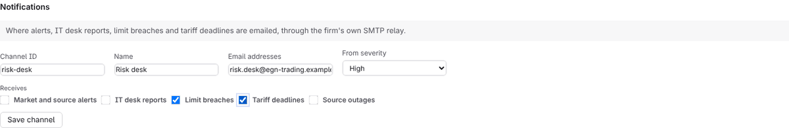
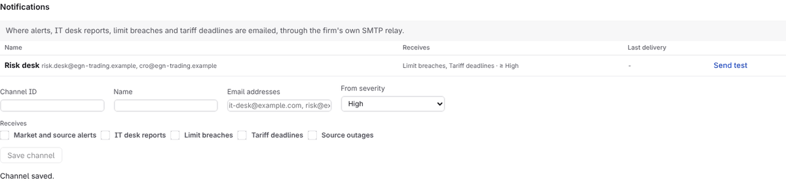
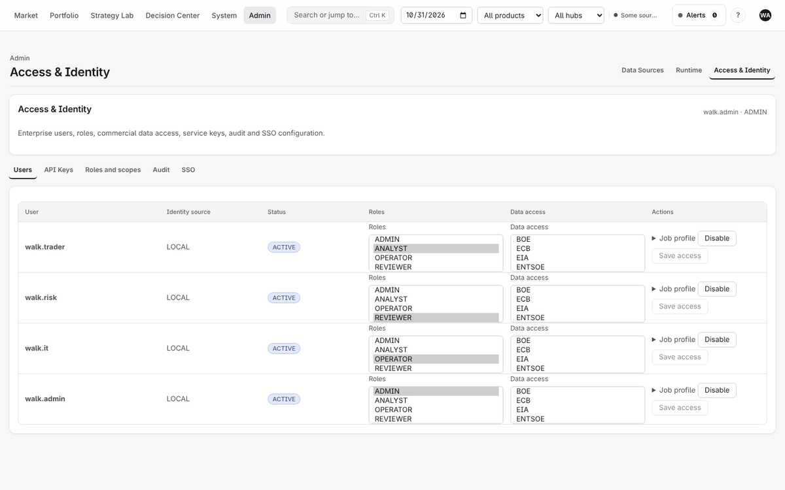

# Administrator manual

For the platform administrator (ADMIN role): who is told what by email, and who may do
what. Administrators manage the platform, not the trading: an administrator does not see
the firm's commercial data unless also granted it. The top bar therefore shows
only Help & Settings and Admin, the sign-in lands on Data sources, and a link into a trading page
brings the administrator back to their own surface.

## First run: approve the public sources

A fresh installation reads ECB, Elexon, National Gas and the other open sources at once.
**ENTSOG** (flows, capacity, network) and **GIE AGSI/ALSI** (storage, LNG) are read only
after an administrator approves them for the firm: their terms ask for attribution and
good-faith reuse, and the product records that someone at the firm accepted them. Until
then Today, the balance and the network say "ENTSOG flows: source not approved" with a link
here, and `/api/health/ready` lists them under `attention`.

Admin → **Data sources** → *Public sources that need your approval*:

1. Each source shows its state in plain words: **Not approved yet**, **Approved, waiting
   for key** (GIE: add the key under Credentials), **Approved**, **Running**, or
   **Failing** with the reason.
2. **Approve this public source** (or **Approve all open public sources**) opens each
   provider's terms summary and attribution, with a link to the provider's terms. Read
   them, confirm the current terms with the provider if your firm requires it, type a
   reason (it goes to the audit log), tick *I have read these terms and accept them for my
   firm* and confirm.
3. The server records who, when, why and which summary was shown (audit event
   `source.approval`) and runs a bounded live check (a small sample, nothing stored). The
   next scheduled read brings the data in.

To withdraw an approval (a terms review, a change of provider terms): **Revoke approval** on
the same panel, with a reason and the confirmation *I understand that this source stops being
read*. The source reads "Not approved yet" again, the next scheduled read is refused, and the
data already stored is kept; the revocation is audited like the approval.

Only an ADMIN may approve or revoke; a job function or work mode never grants it, and the
product never accepts terms by itself. Without a browser: `scripts/ops/approve_public_source.py`
(see [DEPLOYMENT_ROLES-EN.md](../../deployment/DEPLOYMENT_ROLES-EN.md), "First run").

## 1. Route email notifications

Help & Settings → **Settings** → **Notifications**. Alerts go by email through the firm's own SMTP
relay (`EUROGAS_NEXUS_SMTP_*` on the server); nothing leaves the firm by another route.

1. Channel ID (`risk-desk`) and a name (`Risk desk`).
2. Email addresses, comma separated.
3. **From severity**: only notifications at or above it are sent (`High` for the risk
   desk; `Medium` for the IT desk).
4. **Receives**: tick the categories: market and source alerts, IT desk reports, limit
   breaches, tariff deadlines, source outages. None ticked means all.
5. **Save channel**, then **Send test** to check delivery. The table shows each channel's
   last delivery.

A notification is written once, however many times its cause is seen, and retried three
times five minutes apart; each attempt is recorded.

## 2. People and access

Admin → **Access & Identity**: people, their role (viewer, reviewer, analyst, operator,
admin), job functions and data scopes; API keys; single sign-on. With directory
provisioning, roles follow the person's directory groups at every sign-in. A job function
(trader, risk, IT) describes the person; it never grants access by itself.

Roles and responsibilities in full: [ROLES_AND_RESPONSIBILITIES.md](../../product/ROLES_AND_RESPONSIBILITIES.md).
