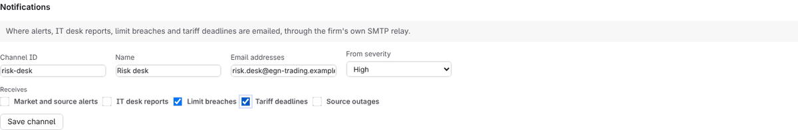
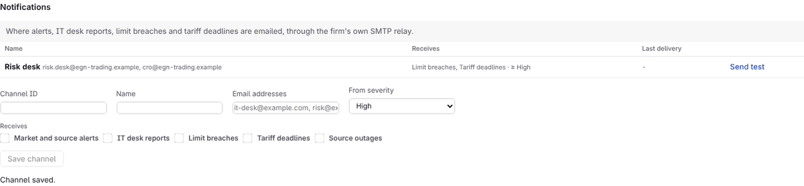
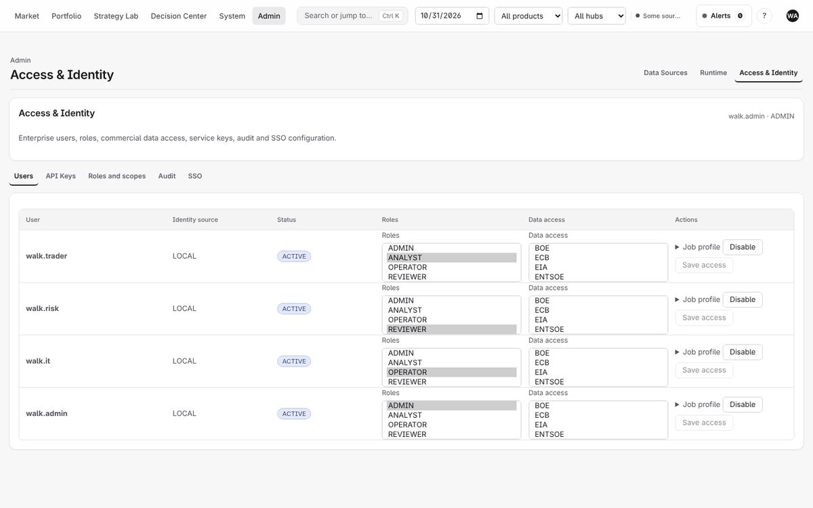

# Administrator manual

For the platform administrator (ADMIN role): who is told what by email, and who may do
what. Administrators manage the platform, not the trading: an administrator does not see
the firm's strategies or market data unless also granted them. The top bar therefore shows
only System and Admin, the sign-in lands on Data sources, and a link into a trading page
brings the administrator back to their own surface.

## 1. Route email notifications

System → **Settings** → **Notifications**. Alerts go by email through the firm's own SMTP
relay (`EUROGAS_NEXUS_SMTP_*` on the server); nothing leaves the firm by another route.

1. Channel ID (`risk-desk`) and a name (`Risk desk`).
2. Email addresses, comma separated.
3. **From severity**: only notifications at or above it are sent (`High` for the risk
   desk; `Medium` for the IT desk).
4. **Receives**: tick the categories: market and source alerts, IT desk reports, limit
   breaches, tariff deadlines, source outages. None ticked means all.
5. **Save channel**, then **Send test** to check delivery. The table shows each channel's
   last delivery.

A notification is written once, however many times its cause is seen, and retried three
times five minutes apart; each attempt is recorded.

## 2. People and access

Admin → **Access & Identity**: people, their role (viewer, reviewer, analyst, operator,
admin), job functions and data scopes; API keys; single sign-on. With directory
provisioning, roles follow the person's directory groups at every sign-in. A job function
(trader, risk, IT) describes the person; it never grants access by itself.

Roles and responsibilities in full: [ROLES_AND_RESPONSIBILITIES.md](../../product/ROLES_AND_RESPONSIBILITIES.md).
