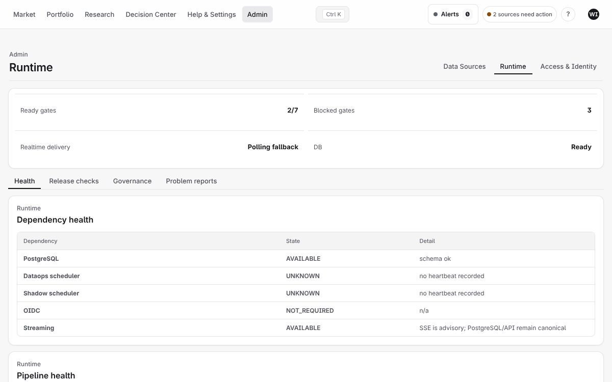
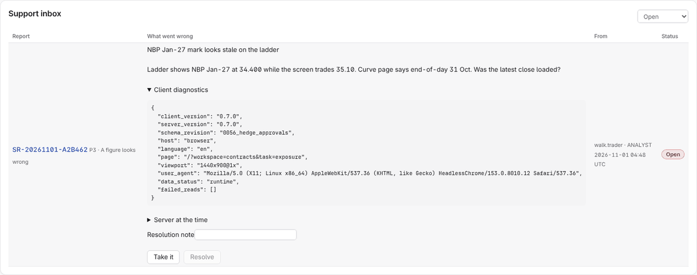
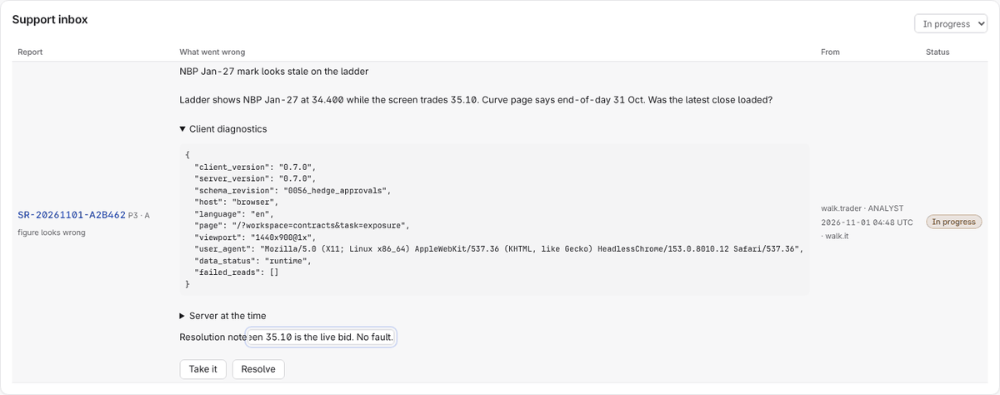
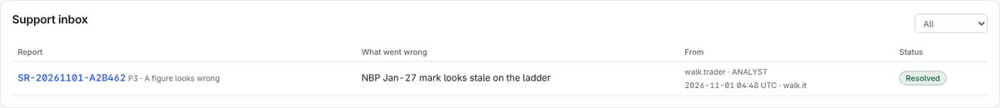
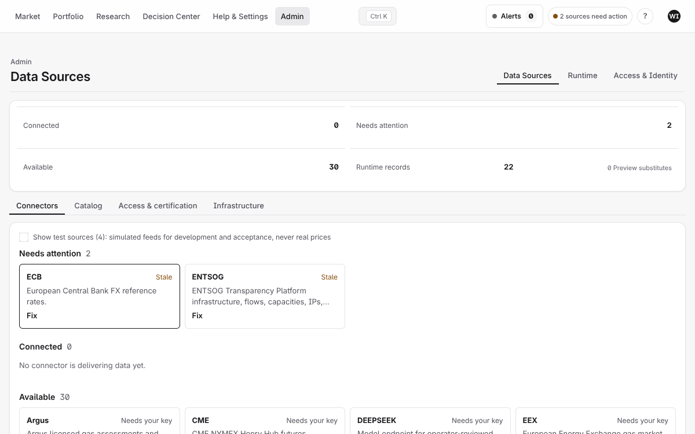

# IT desk manual

For the IT desk (OPERATOR role): problem reports from users, and the health of data
sources and the platform. Your workspace is **Admin**: Data Sources, Runtime, and Access &
Identity.

## 1. Work a problem report

Users report problems from the **?** in their top bar. Each report arrives by email to
the channels routed for "IT desk reports" (see the [administrator manual](ADMIN.md)) and
under Admin → **Runtime** → **Problem reports**.

1. Open the report. Its diagnostics show the page, the client and server versions, the
   schema revision, screen size and scaling, the desktop or browser host, and any failing
   reads with their codes and correlation ids. **Server at the time** shows which sources
   were failing when it was sent. No prices, positions or contract terms are attached.

   

2. **Take it**: the report moves to "In progress" with your name, and the reporter sees
   that under **My reports**.
3. Investigate, then write the resolution note (what you found and what you did) and
   **Resolve**. A report cannot be resolved without a note. Every step is audited.

   

   

## 2. Check the platform

Admin → **Data Sources** opens on **Connectors**: *Needs attention* (something that was set
up and stopped working: a failure, a stale feed, a lost key), *Connected* and *Available*
(offered but never set up). An optional provider that needs the customer's own key (GIE,
ENTSO-E, EEX, ICE) sits under Available until it is connected; it is not an outage. The
**Catalog** tab keeps the full table with freshness, next run and failures.

Admin → **Runtime** opens on **Health** (dependencies, pipeline runs, quote freshness).
**Release checks** holds the release gates (database and schema, scheduler, realtime
delivery, certification, security acceptance); **Governance** and **Problem reports**
follow.

Scheduled operations the IT desk runs (cron or the Windows task scheduler):

| Job | Command | When |
|---|---|---|
| Monitoring and notifications | `python scripts/ops/run_monitoring_worker.py` | Continuously |
| LNG terminal tariffs | `python scripts/ops/refresh_lng_terminal_tariffs.py` | Daily |
| TSO tariff publications | `python scripts/ops/check_tariff_publications.py` | Daily |
| Contract deliveries | `python scripts/ops/import_contract_deliveries.py` | Daily, after the TSO allocation |
| Notification retries | `python scripts/ops/dispatch_notifications.py` | Every 5 minutes, if the worker is not running |

Updates, versions and the support process: [SUPPORT_AND_UPDATES.md](../../guides/SUPPORT_AND_UPDATES.md).
