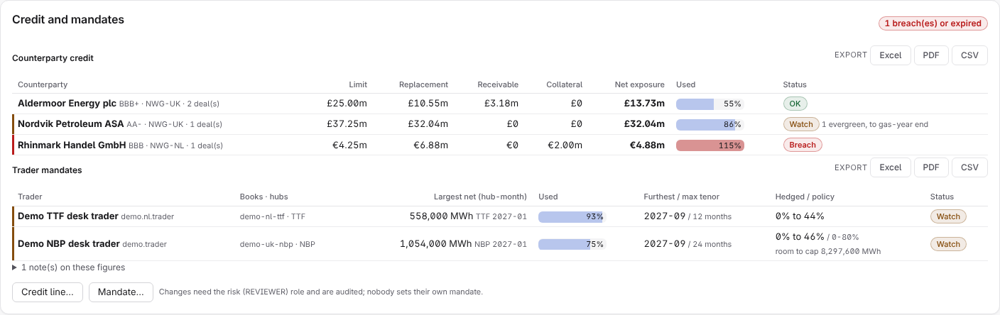
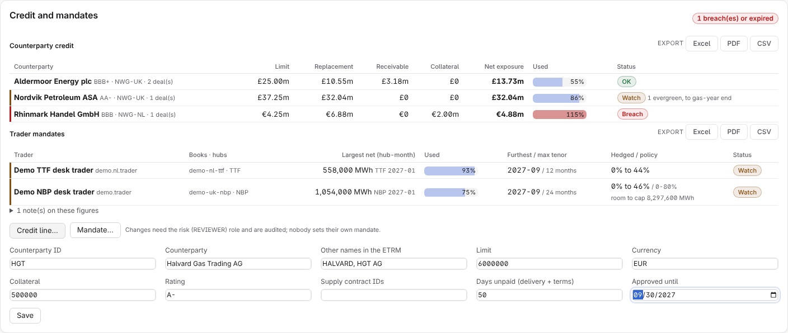
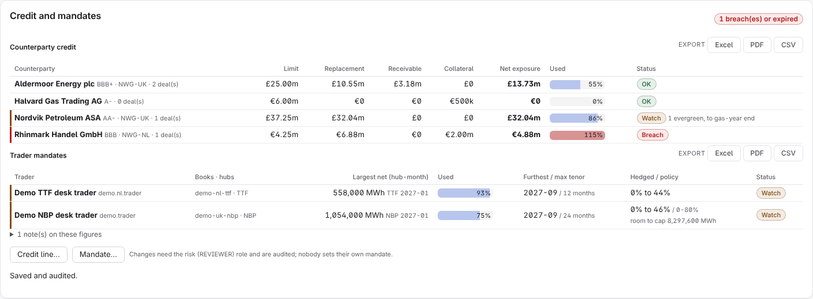
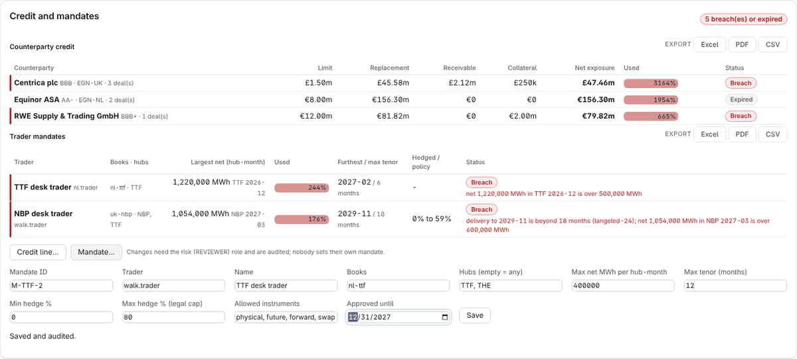
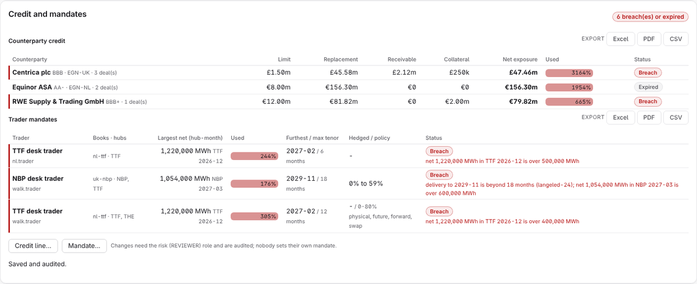
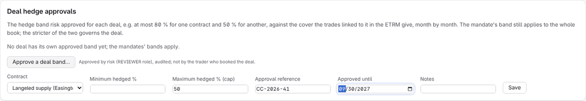
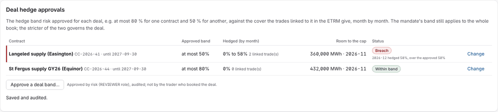
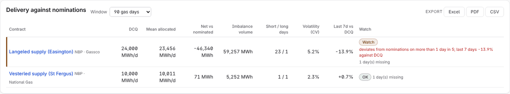

# Risk and middle-office manual

For the risk function: counterparty credit, trader mandates, per-deal hedge approvals and
delivery performance. Limits are set by risk only. Your account needs the REVIEWER role
(traders are analysts and cannot set their own limits, whatever their rank), and every
change is audited with your name.

The screenshots use the fictional demo desk (`docs/guides/DEMO_DESK.md`); every name in
them is invented and its prices are demo prices, flagged as such on screen.

Everything below is under Portfolio → **Exposure**, except delivery performance (under
Resources).

## 1. Read the credit and mandate board

**Counterparty credit**, one row per credit line:

| Column | Meaning |
|---|---|
| Limit | The approved line, in its currency |
| Replacement | What replacing the remaining deliveries would cost today: volume × (mark − contract price), netted across the counterparty's deals, never below zero. An open-ended (evergreen) contract counts only to the end of the current gas year, since it renews yearly and can be ended on notice; the status cell says "N evergreen, to gas-year end" |
| Receivable | Gas delivered to them and not yet paid for, over their payment days |
| Collateral | Letters of credit and guarantees held |
| Net exposure | Replacement + receivable − collateral |
| Used | Net exposure as a share of the limit |
| Status | OK, watch, breach, expired (the line's approval date has passed) or incomplete (a deal could not be valued) |

**Trader mandates**, one row per mandate: largest net position per hub-month against the
limit, furthest delivery against the maximum tenor, the hedge ratio range against the
policy band, and every breach in words (a hub outside the mandate, a delivery beyond the
tenor, an instrument not allowed, over- or under-hedged).

Each table exports to Excel, PDF or CSV for the daily risk report.

## 2. Set a counterparty credit line

**Credit line…** opens the form:

1. Counterparty ID (`HGT`) and legal name (`Halvard Gas Trading AG`).
2. Aliases, comma separated (`HALVARD, HGT AG`): the names their trades carry in the
   ETRM, so every deal is matched to the line.
3. Limit and currency (`6000000`, `EUR`), collateral held (`500000`), rating (`A-`).
4. Contracts under the line (their supply contract IDs, if any), days until receivables
   are paid (`50`) and the approval's expiry (`2027-09-30`).
5. **Save**: "Saved and audited." The line appears on the board.

## 3. Set a mandate with a hedge cap

**Mandate…**:

1. Mandate ID (`M-TTF-2`), the trader's sign-in (`walk.trader`) and a display name.
2. Books (`nl-ttf`) and hubs (`TTF, THE`); empty hubs mean any.
3. Maximum net per hub-month (`400000` MWh) and maximum tenor (`12` months).
4. **Minimum hedged %** and **Maximum hedged % (legal cap)**: for a legal limit of "hedge
   at most 80 %", minimum `0`, maximum `80`.
5. **Allowed instruments**: `physical, future, forward, swap`. Leaving out `option` makes
   any option trade a breach.
6. Approval expiry, then **Save**.

You cannot set a mandate for yourself (four eyes). A trader with mandates for two books
is measured book by book: a trade in the NBP book is the NBP mandate's business, not a
breach of the TTF one. A trade booked outside all their books is still caught.

## 4. Approve a hedge band for a deal

A mandate's band governs a book. When a committee approves a band for one deal (at most
80 % for one supply contract, 50 % for another), record it under **Deal hedge
approvals** → **Approve a deal band…**:

1. Choose the contract. The list shows the contracts in positions, by name and hub,
   without prices.
2. Minimum and maximum hedged % (`50`), the approval reference (`CC-2026-41`) and its
   expiry.
3. **Save**.

The cover is measured month by month from the trades your ETRM links to that contract.
Selling forward 60 % of a month against a 50 % approval is a breach. **Room to the cap**
says how much more can be hedged in the next month. When a deal has its own band and its
book has a mandate band, the stricter of the two governs the deal.

## 5. Delivery performance

Portfolio → **Resources** → **Delivery against nominations**: per contract, delivered
against nominated over 30, 90 or 365 gas days, days short beyond tolerance, the imbalance
volume and the last 7 days. A supplier that under-delivers increases what the desk must
buy within day; it also feeds the sell-down plan and the daily balance's expected supply.

