# Trader manual

For a gas trader running a physical book: supply contracts delivering into NBP or a
continental hub, hedged on the exchange and bilaterally. Every step below was done in the
product as written; the screenshots are what it showed. Your firm's names and figures
will differ.

Sign in with your company account. You land on Market; your work is mostly under
**Portfolio**: Overview, Resources (contracts and daily balance), Routes (capacity, LNG,
tariffs) and Exposure (positions, limits).

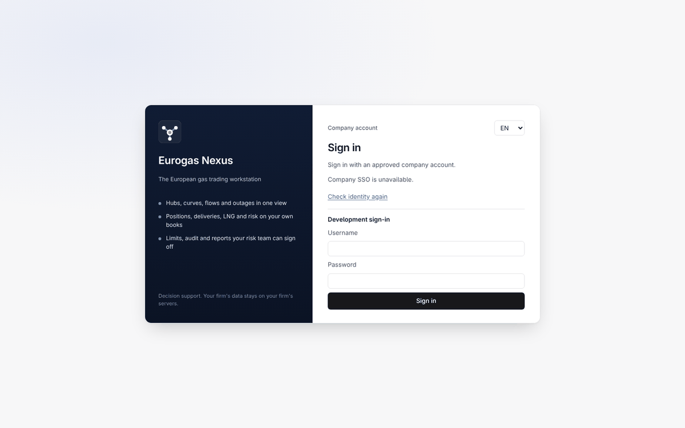

## 1. Enter a new supply contract

Portfolio → **Resources** → **New draft**. The draft starts empty except for desk
conventions (EFET form, current gas year, tolerances, monthly settlement). Facts only the
contract can state are blank, and **Save to pool** stays disabled until they are filled;
the Validation box on the right says what is missing.

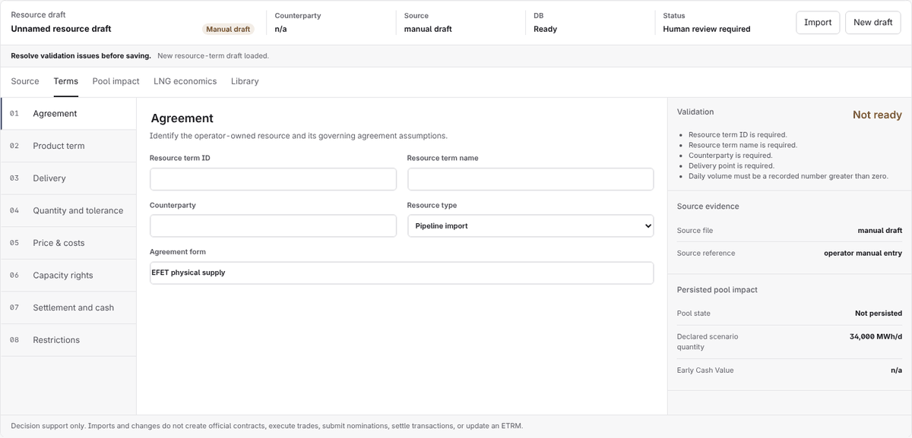

1. **Agreement**: a resource term ID you will recognise (`stfergus-equinor-gy26`), a
   name (`St Fergus supply GY26 (Equinor)`), the counterparty (`Equinor ASA`) and the
   resource type (pipeline import, beach delivery, LNG regasification, storage, pool).

   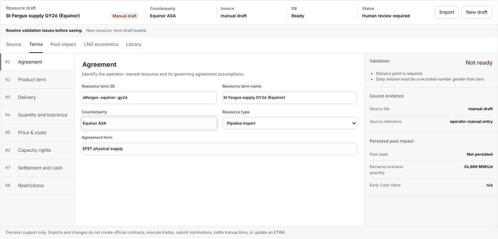

2. **Delivery**: choose the delivery point, title-transfer point and physical exit point
   from the list. It holds the hubs first (NBP, TTF, THE, PEG, ZTP, PSV, CEGH, PVB), then
   the points of your route network. You cannot type a point that positions and routing
   would not recognise. If a stored contract records a point outside the list, it is
   kept and shown as "as recorded".

   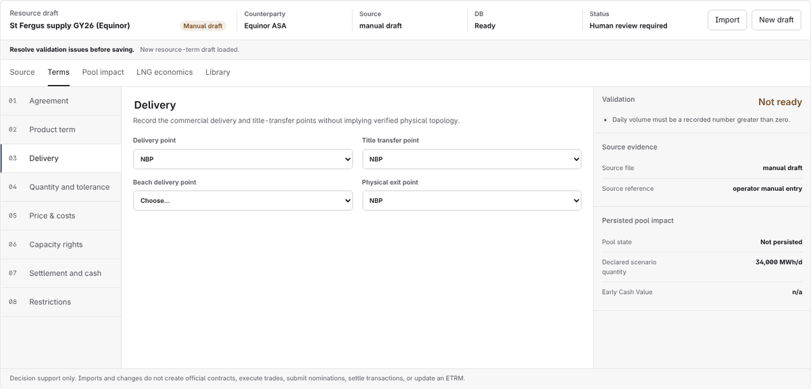

3. **Product term**: the index basis follows the delivery hub (`NBP day-ahead`, month-,
   season- or gas-year-ahead, fixed price, oil-indexed).

   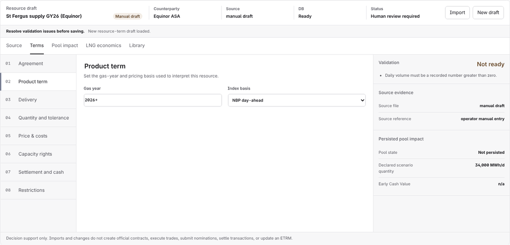

4. **Quantity and tolerance**: daily contract quantity in MWh/d (`18000`), delivery
   tolerance (`5` %) and nomination tolerance (`2` %).

   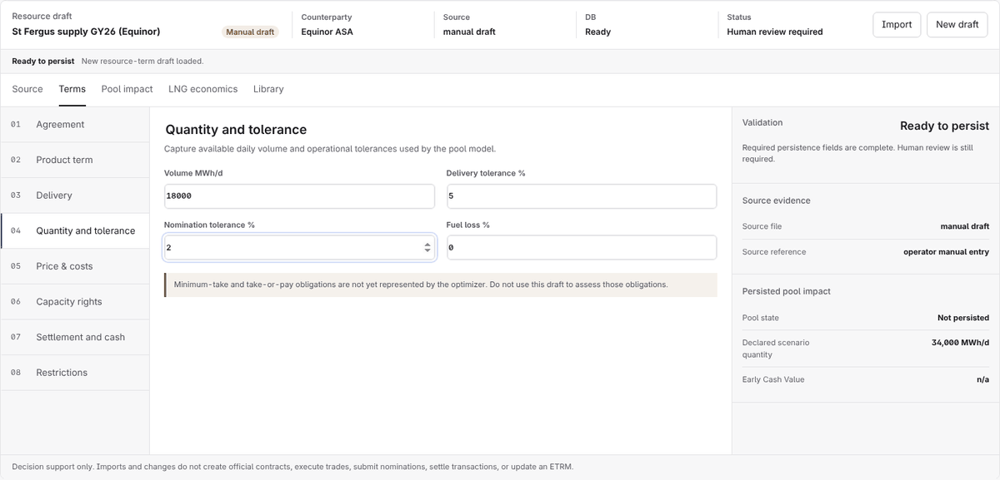

5. **Price & costs**: the contract price in GBP/MWh (`30.85`) and any variable costs.
   Prices are recorded in GBP/MWh today; a contract delivered at a euro hub says so and is
   not marked to market (keep its valuation in the ETRM).

   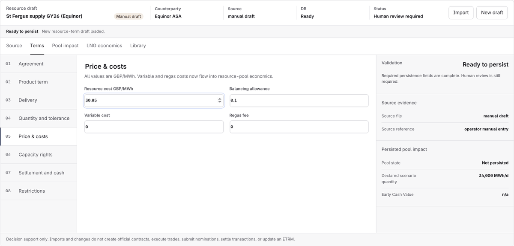

6. **Capacity rights** and **Settlement and cash**: entry capacity held (`19000` MWh/d),
   capacity expiry as a date, governing law from the list (`English law`), payment lags
   and the financing rate (look it up from SONIA, €STR or SOFR).

   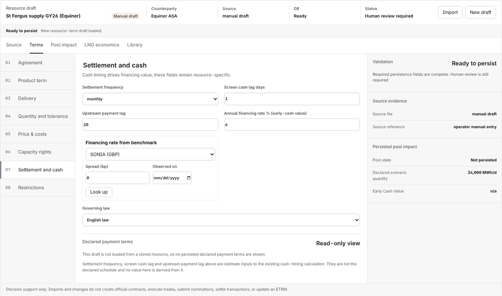

7. **Restrictions**: tick where the gas may be taken (exit hubs) and how it may be sold.

   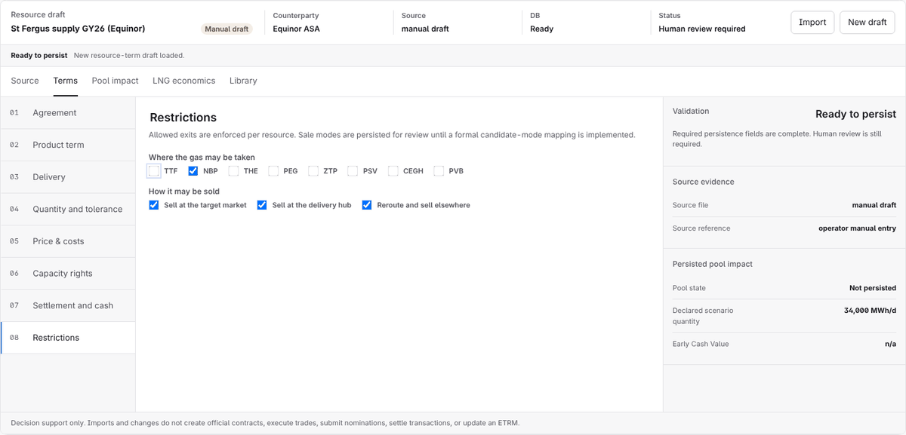

8. **Save to pool** (top right, beside the tabs). The contract is stored with you as its
   author; it enters positions, risk and the map. Nothing is nominated or traded.

   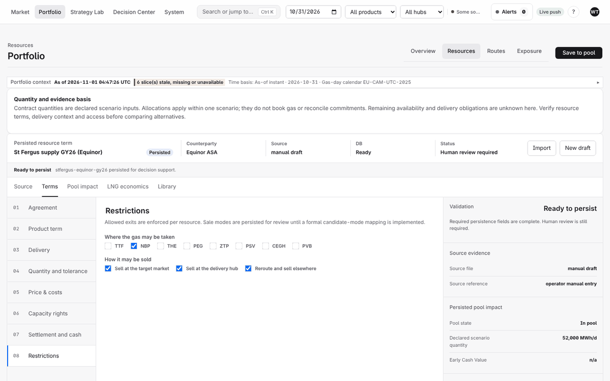

The **Library** tab lists stored contracts with volume, price and when they were saved.

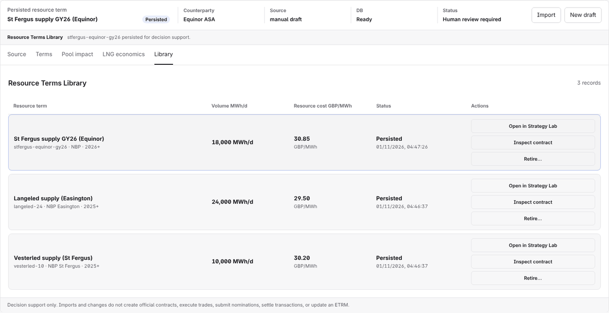

## 2. Read a confirmation PDF into a draft

**Import** (top right of the contract) and choose the signed confirmation PDF. Every term
the reader recognises is listed with the page and the words it came from, converted to
desk units (therms per day to MWh/d, pence per therm to GBP/MWh). The draft is filled but
not saved: check each term against the page, complete what is missing (here the name),
then save.

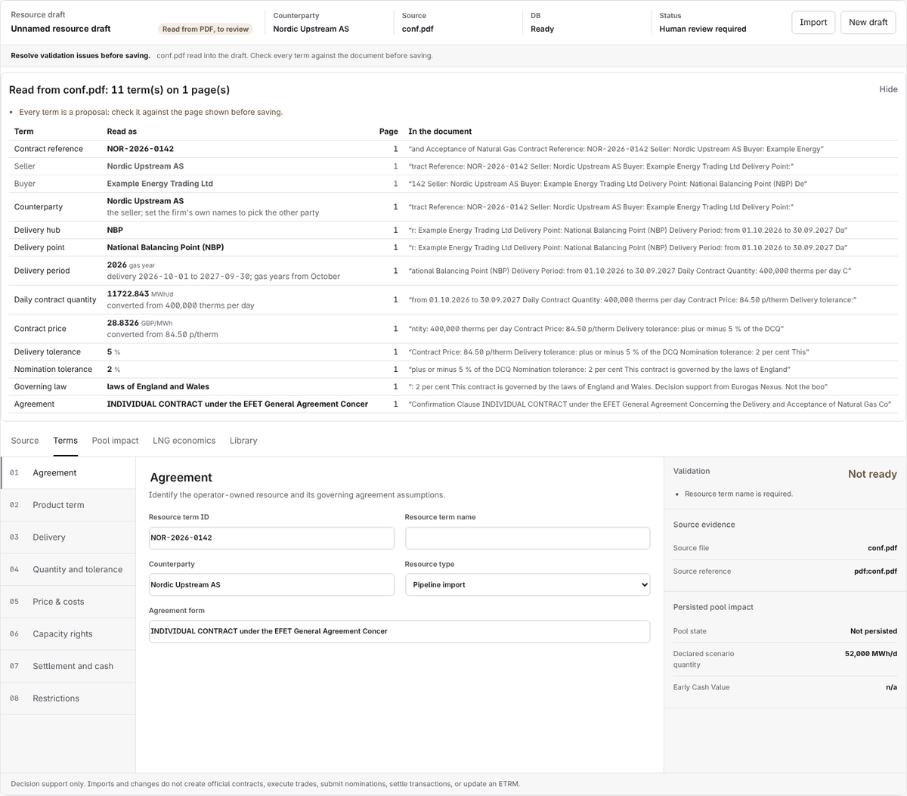

Scanned PDFs are read when the server has Tesseract installed.

## 3. Retire and reinstate a contract

A contract is never deleted: it is retired, so its history and audit stay.

1. Library → **Retire…** on the contract, give the reason (`Terminated by mutual consent
   31 Oct 2026 (letter ref. VL-2026-114)`).

   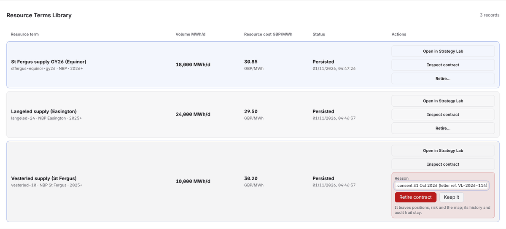

2. **Retire contract**. It leaves positions, risk and the map, and appears under
   **Retired contracts** with who retired it, when and why.

   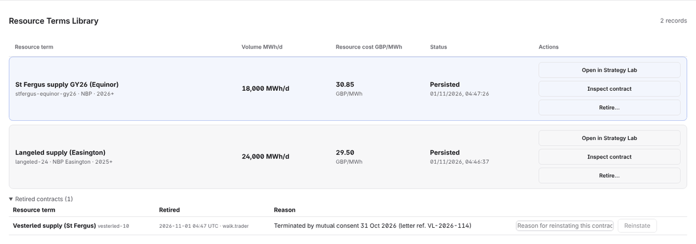

3. If the termination is withdrawn, type the reason in the row and **Reinstate**.

   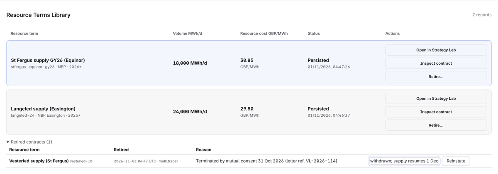

Retiring and reinstating need the contract's current version: if a colleague changed it
since you opened it, you are asked to reload instead of overwriting their change.

## 4. Monitor the book position

Portfolio → **Exposure** → **Position ladder**: physical (contracts) and financial
(trades) volume per hub and month, the net, the hedged share and the mark. Choose the
horizon, roll up by hub, book or legal entity, and the reporting currency.

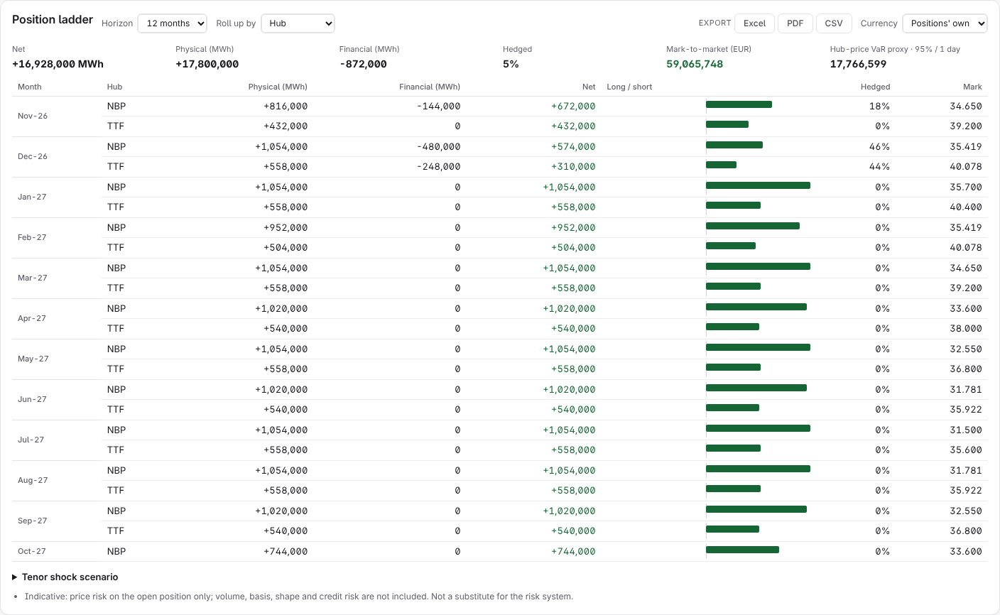

- **Hedged** is the trades' offsetting volume as a share of the contracts' volume. When
  trades point the same way as the physical position (bought on top of a long), they add
  risk instead of hedging it; the cell reads "adds N %" and is flagged.
- Mark-to-market and one-day VaR are indicative (price risk on the open position only).
- **Excel**, **PDF**, **CSV** export the table as shown.

Below it, **Credit and mandates** shows where you stand against your mandate before you
trade: largest net per hub-month against your limit, furthest delivery against your
tenor, your hedge ratio against the policy band, and any breach in words.

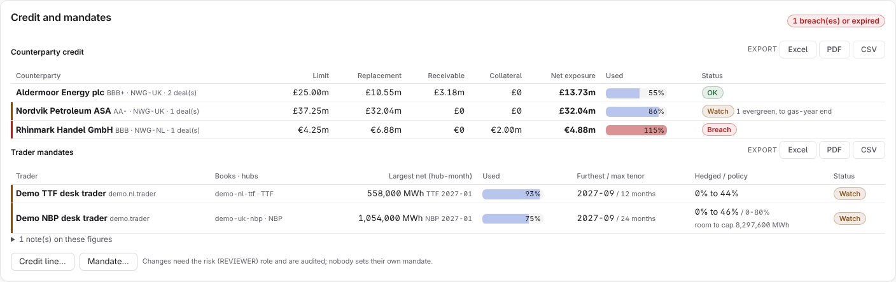

## 5. Balance each gas day

Gas is balanced every gas day: what is still long or short at the end of the day is
cashed out by the TSO at a penal price. Portfolio → **Resources** → **Daily gas balance**
shows, for the next 3, 7, 14 or 31 gas days at a hub:

- **Expected supply**: your contracts' daily quantities corrected by how they actually
  delivered over the last 30 gas days (here 97.2 % of nominated);
- **Exchange** and **Bilateral** (net): day-ahead, within-day, balance-of-month and month
  trades delivering that day, from the screen and from the ETRM;
- **Residual**: still to sell (long) or buy (short), and what the cash-out would cost if
  left, at your own premium and discount.

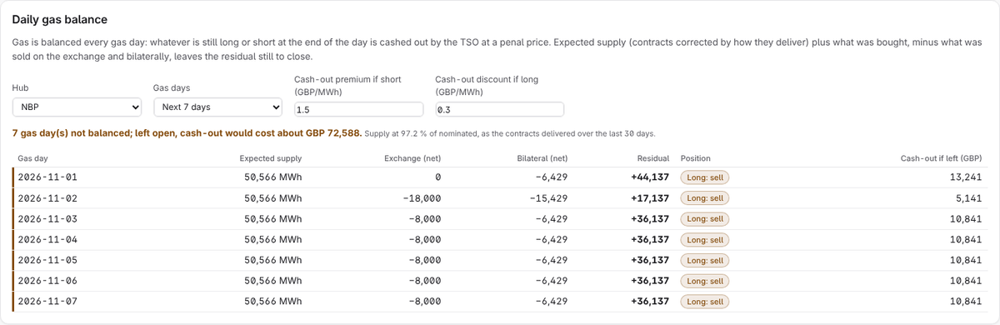

To decide how to close tomorrow's residual, **Tomorrow's sell-down** splits it between
day-ahead and within-day. Type the day-ahead bid and the within-day price you expect, the
premium you pay if short and the discount you take if long, and the lot size, then
**Plan**. It sells less than the expected supply when a shortfall costs more than a
surplus, because supply varies (measured from the contracts' allocations).

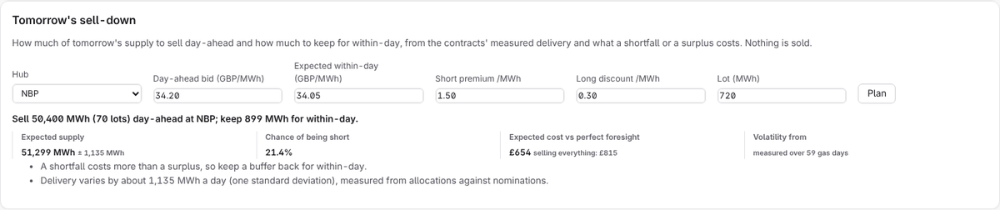

**Delivery against nominations** shows each contract's delivered volume against
nominated, shortfalls beyond tolerance and the last 7 days.

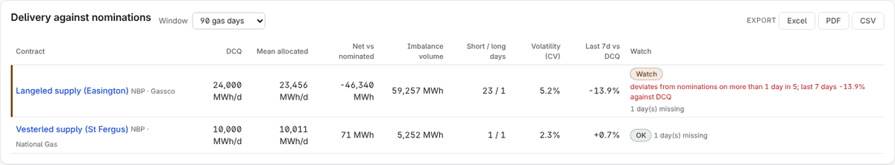

## 6. Price an LNG cargo bid

Portfolio → **Routes** → **LNG cargo bid**. Enter the cargo size (MMBtu or MWh), arrival
month, target margin, boil-off and charter per day, then **Price the bid**. Each
terminal's maximum DES bid is the hub forward for the arrival month less regas (from the
terminal's published tariff: Fluxys indexed slot, Elengy term or SMART SPOT by cargo
class, DET auction, or your own terms where the terminal negotiates), entry, fuel, port,
boil-off and charter. **Terminal terms** shows each terminal's regime and the document its
figures come from.

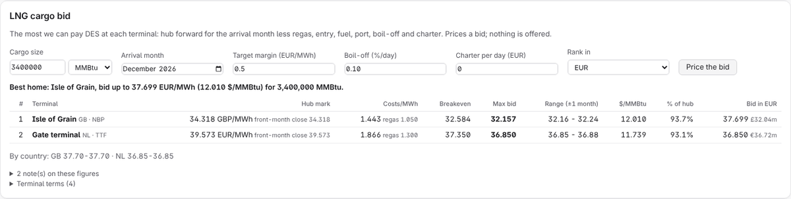

## 7. Track TSO tariff publications

Portfolio → **Routes** → **Tariff publications**. Register each TSO and gas year you hold
capacity in, with the publication page: **Register a publication** → TSO, country, gas
year (`2027/28`), held (expected, indicative or final) and the page URL → **Save**. The
final tariff is due 30 days before July's annual yearly auction (NC TAR); the register
shows the due date, whether the page changed since you last reviewed it, and emails the
desk when it does.

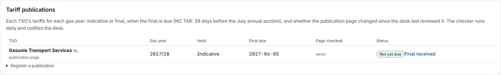

## 8. Look up a term

System → **Glossary**: 74 desk terms with unit, formula, a worked example, where the term
appears in the product and the regulation behind it, in English and Chinese.

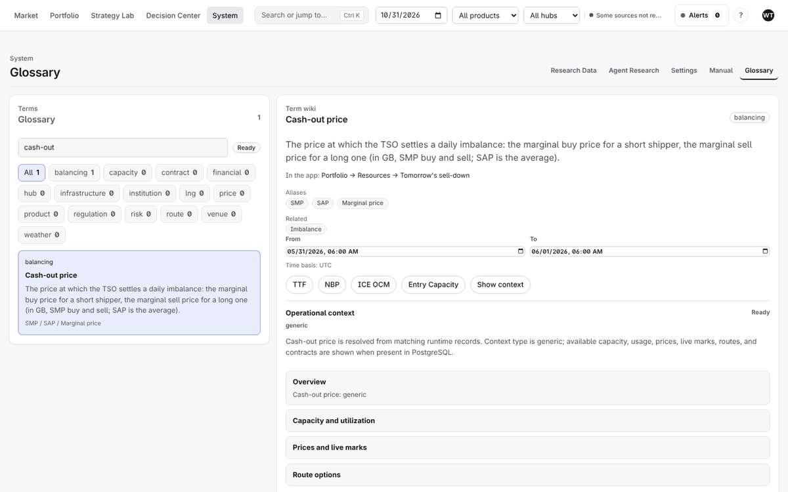

## 9. Report a problem

The **?** in the top bar → **Report a problem**. Say what went wrong, the kind and the
urgency, and the details. The page, versions, screen size and any failing reads are
attached; no prices, positions or contract terms are sent. **My reports** follows what the
IT desk did with it.

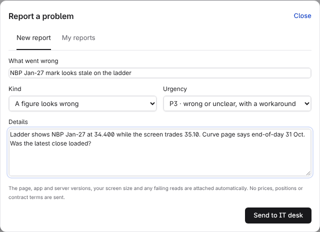

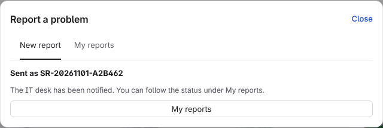
