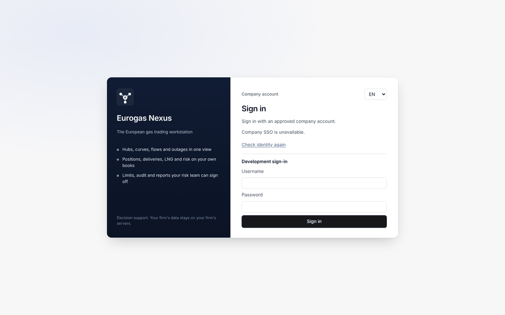
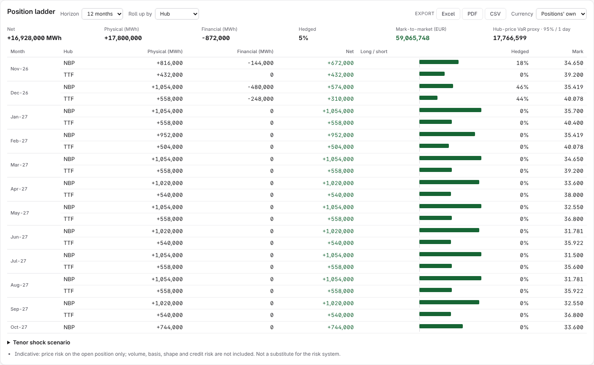
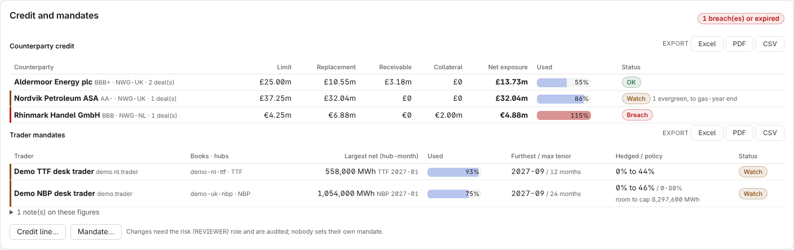
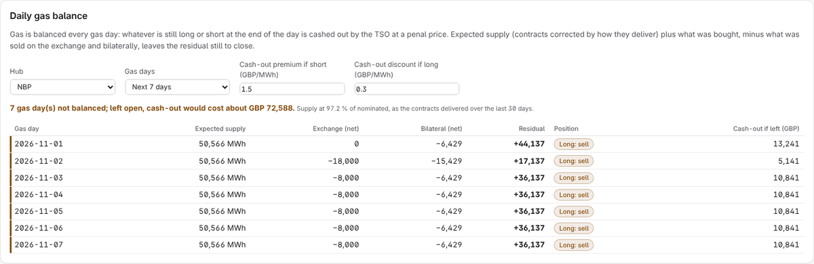
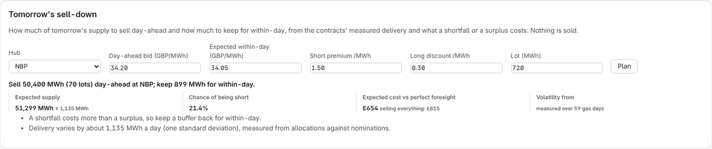
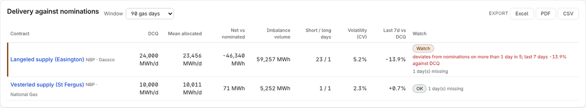
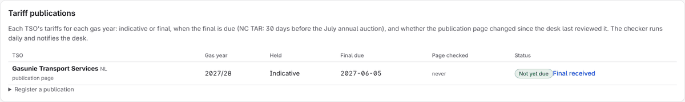
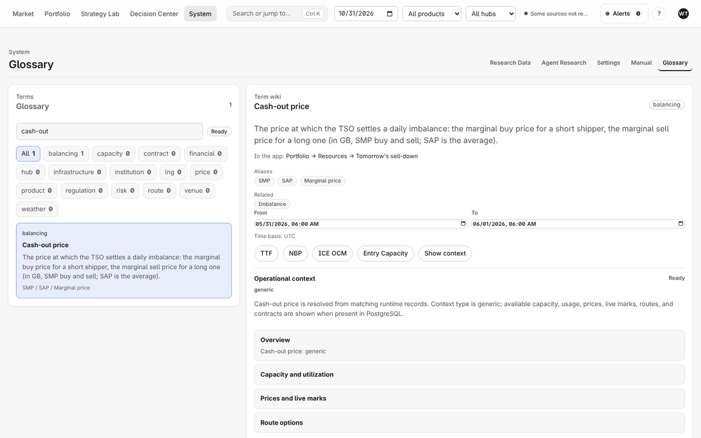
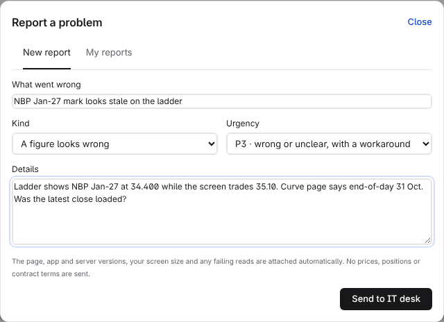
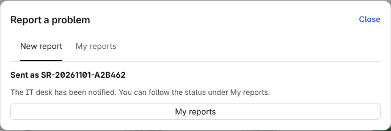

# Trader manual

For a gas trader running a physical book: supply contracts delivering into NBP or a
continental hub, hedged on the exchange and bilaterally. Every step below was done in the
product as written; the screenshots are what it showed. Your firm's names and figures
will differ.

Sign in with your company account. The top bar has four modes: **Desk**, **Deals**, **Book**
and **Research**. You land on Desk. Its first task, **Today**, answers
"what changed, and does it touch us?" in rows chosen for your job: **My market** (front-month
prices with their day change), **What needs me** (open alerts, outages and findings, each with
**Why**), **My book** (position, mark and day P&L change by hub) and **Fundamentals** (storage
fill and the supply call, with the north-west Europe balance below). Traders and operations
also see **My gas day** (per hub: what comes in, what goes out and the net still to clear,
for the books of your mandate, today or tomorrow) and the **Gas day checklist** (each
source's nomination status, mismatches and LNG terminal steps; the time left turns amber,
then red, as the deadline nears). A status you set on the checklist is your own record,
labelled as entered by hand; nothing is nominated from Eurogas Nexus. A figure that is not
current says so in words beside it ("late 3 h", "stale 2 d"); the link at the right of the
context line lists every such figure and takes you to it. Simulated figures carry "sim"
beside the value, and the demo desk says "Demo data" once. Risk figures have a **Method**
note: what the figure includes and what it leaves out.

Under the top bar a single line, the **situational strip**, tells you when something needs you
now: a large unplanned outage where your book holds a position or at one of your focus hubs, or a
breach of your own mandate. When nothing does, it shows one quiet fact (trades booked today from
the ETRM import, read-only, or the next nomination window), or nothing at all. It never shows
data-pipeline state. See [the situational strip](../SITUATION_STRIP.md); its thresholds are under
Settings → Personal preferences → Situational strip.

Your work is mostly under **Deals** (Opportunities, Contracts, Review) and **Book**
(Position, Limits & P&L, Delivery for the daily balance and sell-down, Planning for
nominations and the storage plan). **Research** holds Fundamentals, Spreads, Cargo & netback
and Reports. Help & Settings and Administration are in the account menu. A page that is
empty on a new installation offers **See an example**, and the first time you open a page
up to three tips point at its main controls (Help & Settings replays them).

## 1. Enter a new contract

Deals → **Contracts** opens the contract list: every stored contract with its kind, volume,
status (In execution, Starts later, Expired, Retired), counterparty, delivery point and
period. Cargo confirmations sit under their LNG master agreement. Find a contract,
counterparty or point with the search box, or narrow the list with **Kind of contract**.
Click a row to open the contract.

**New contract** (above the list) asks first for the kind of contract:

| Kind | What it holds |
|---|---|
| Gas supply agreement | Term supply at a point: DCQ, period, price, tolerances |
| Upstream tender | A producer's gas bought by tender: DCQ with a min–max swing, index ± differential |
| LNG master agreement (MSPA) | The frame cargoes are confirmed under: delivery terms, laytime, demurrage, credit support |
| LNG cargo confirmation | One cargo under an MSPA: FOB or DES, window, size, price formula |
| LNG term SPA, Hub trade (EFET / NBP), Transport, LNG terminal and Storage capacity | Their own terms |

The form then shows only that kind's terms, grouped as Parties and master, Quantity and
quality, Delivery, Price, Flexibility, and Payment and credit. Terms marked * are needed to
save; until they are filled the form says what is still needed. Anything the form does not
hold yet (price review, heel, make-up) is kept word for word.

1. **Delivery**: choose the delivery point from the list. It holds the hubs first (NBP,
   TTF, THE, PEG, ZTP, PSV, CEGH, PVB, and the Danish hub ETF, which OTC calls GTF: one hub
   under either name), then the points of your route network. You cannot type a point that positions
   and routing would not recognise. A stored point outside the list is kept and shown as
   "as recorded".
2. **Quantity as written**: in the contract's own unit (an NBP contract in therms per day,
   a continental one in MWh/d). The book reads it in MWh/d and the form says what it
   reads ("The book reads: NBP · Oct 2026 – Sep 2027 · 18,000 MWh/d").
3. **Price**: choose the basis: **Fixed**, **Index ± premium** (index, product, averaging
   over a number of trading days, publication, premium; a negative premium is a discount)
   or **Formula** (weighted indices plus a constant, with an optional **Floor** and
   **Cap**). The price is kept in its own unit, NBP in pence per therm; an LNG cargo is
   priced per cargo on its confirmation.
4. **Save contract**. The contract is stored with you as its author; it enters positions,
   risk and the map. Nothing is nominated or traded.

An opened contract reads its terms in words first, then **Edit**, **Inspect** and
**Retire…**. **Edit price and quantity** changes just those terms; the price panel shows
the contract's price for a chosen delivery month and the index closes it read.

## 2. Read a contract PDF into a new contract

**Import PDF** (beside **New contract**) and choose the signed contract or confirmation.
The reader proposes the kind and fills that kind's form; every term it recognises is listed
with the page and the words it came from. Nothing is saved: check each term against the
page, complete what is missing, then **Save contract**.

Scanned PDFs are read when the server has Tesseract installed.

## 3. Retire and reinstate a contract

A contract is never deleted: it is retired, so its history and audit stay.

1. Open the contract → **Retire…**, give the reason (`Terminated by mutual consent
   31 Oct 2026 (letter ref. VL-2026-114)`) → **Retire contract**. It leaves positions,
   risk and the map, and appears under **Retired contracts** below the list with who
   retired it, when and why.
2. If the termination is withdrawn, type the reason in its row there and **Reinstate**.

Retiring and reinstating need the contract's current version: if a colleague changed it
since you opened it, you are asked to reload instead of overwriting their change.

## 4. Monitor the book position

Charts on Today (storage fill against the previous year and the EU target, NW Europe supply
and call) and on Desk → **Prices** show their unit and as-of time in the head and say
"Simulated" on demo data. Prices has three views: the **Hub board** (each hub in its own
quotation, NBP in p/th, TTF in EUR/MWh; your reporting currency and unit on hover), the
**Ladder** (forward curve by delivery month) and **Prompt** (within-day and day-ahead). **Table** shows the same
figures as a table, **CSV** downloads exactly what is plotted, and with the chart focused the
Left/Right arrow keys step through the points.

Book → **Position** → **Position ladder**: physical (contracts) and financial
(trades) volume per hub and month, the net, the hedged share and the mark. Choose the
horizon, roll up by hub, book or legal entity, and the reporting currency. Marks are in the
hub's own quotation (NBP in pence per therm, TTF in EUR/MWh); hover a mark for the per-MWh
value the book is valued at. The ladder is only on Position: Limits & P&L links to it.

- **Hedged** is the trades' offsetting volume as a share of the contracts' volume. When
  trades point the same way as the physical position (bought on top of a long), they add
  risk instead of hedging it; the cell reads "adds N %" and is flagged.
- Mark-to-market and one-day VaR are indicative (price risk on the open position only).
- **Excel**, **PDF**, **CSV** export the table as shown.

On Book → **Limits & P&L**, **Credit and mandates** shows where you stand against your mandate before you
trade: largest net per hub-month against your limit, furthest delivery against your
tenor, your hedge ratio against the policy band, and any breach in words.

## 5. Balance each gas day

Gas is balanced every gas day: what is still long or short at the end of the day is
cashed out by the TSO at a penal price. Book → **Delivery** → **Daily gas balance**
shows, for the next 3, 7, 14 or 31 gas days at a hub:

- **Expected supply**: your contracts' daily quantities corrected by how they actually
  delivered over the last 30 gas days (here 97.2 % of nominated);
- **Exchange** and **Bilateral** (net): day-ahead, within-day, balance-of-month and month
  trades delivering that day, from the screen and from the ETRM;
- **Residual**: still to sell (long) or buy (short), and what the cash-out would cost if
  left, at your own premium and discount.

To decide how to close tomorrow's residual, **Tomorrow's sell-down** splits it between
day-ahead and within-day. Type the day-ahead bid and the within-day price you expect, the
premium you pay if short and the discount you take if long, and the lot size, then
**Plan**. It sells less than the expected supply when a shortfall costs more than a
surplus, because supply varies (measured from the contracts' allocations).

**Delivery against nominations** shows each contract's delivered volume against
nominated, shortfalls beyond tolerance and the last 7 days.

### Scheduler: why trades, confirmations and nominations disagree

If you schedule (operations), Today shows a **Reconciliation** row under the gas day
checklist. For today or tomorrow, each line is one hub (and point, where the scheduling file
names it) and counterparty: what was **Traded** (bilateral deals from the ETRM, signed + into
the firm), **Confirmed** by the counterparty, **Nominated** and **TSO matched**, in the hub's
desk unit. A dash means nothing was imported for that column, not zero. Exchange trades are
counted under the table and not reconciled: the exchange's clearing house nominates them.

A line with a break shows a chip per break and the time left to the hub's next cut-off
(amber within 3 hours, red within the hour, "No renomination left" once the last
renomination has passed). Select the counterparty's name (or Tab to it and press Enter) to
read each break in words: the arithmetic (for example "6,000 − 4,800 = 1,200 MWh cut"), the
MWh and kWh/h at risk, the next step and an indicative cash-out at your book's approved rate.
Filter by hub, break or counterparty, or show breaks only; **Export CSV** saves one row per
break. A break within 3 hours of its cut-off also appears in **What needs me** for traders and
operations, and as a nomination notification; it is withdrawn when the break is fixed.

Nothing here nominates, confirms or sends anything: fix the nomination in your scheduling
system, and the next import shows whether the break is gone. The matching columns the
scheduling import accepts are in
[the import contracts](../../integration/ETRM_ERP_IMPORT_CONTRACTS.md).

## 6. Study a cargo and its netback

Research → **Cargo & netback** prices a cargo from load to the hubs it can reach: freight,
regas, entry and fuel at each terminal the firm has terms for, the netback per terminal in
one currency at forward FX, and Henry Hub history as the default US reference. A confirmed
LNG cargo under Deals → Contracts opens its own study. Deals → **Opportunities** lists what
the evaluators found (locational spreads, held capacity, sell-down, storage time spread,
re-route through the pool, and a market lane "in the market, not on your book"), ranked by
net edge per MWh after tariffs. Research → **Spreads** shows the spread board and lets you
**Describe it** in plain words ("forward spread net of transport tariff between TTF and
NBP"); a route between hubs that are not neighbours is priced over the cheapest chain of
crossings, at the tariffs the TSOs publish on ENTSOG.

## 7. Track TSO tariff publications

Administration → **Data Sources** → **Infrastructure** → **Tariff publications** (a register,
not a desk page, since commercial design basis 2). Register each TSO and gas year you hold
capacity in, with the publication page: **Register a publication** → TSO, country, gas
year (`2027/28`), held (expected, indicative or final) and the page URL → **Save**. The
final tariff is due 30 days before July's annual yearly auction (NC TAR); the register
shows the due date, whether the page changed since you last reviewed it, and emails the
desk when it does.

Where ENTSOG publishes no tariff for a leg, an operator enters the TSO's published charge
under Administration → **Data Sources** → **Access & certification** → *Transmission tariffs
ENTSOG does not publish*. A second person reviews it (four eyes); until then routes priced
over that leg say the price is indicative, and a published ENTSOG row replaces the entry.

## 8. Draft the morning brief or end-of-day report

Desk → Today → **Desk brief**, or Ctrl K and type "brief". The draft has fixed
sections from the desk's data, each line traceable to its source: alerts, outages in the
next 36 hours, front-month prices and the day's change, positions today and for the front
month, credit and mandates near or over their limits, and P&L. Edit it in place, then
copy it, download it or open it in your email. Nothing is sent from Eurogas Nexus. When
the firm enables a model, a short lead may head the draft; it is checked against the
sections and says so. On a demo deployment the draft states that its prices are simulated.

### Market reports

Research → **Reports** builds a full market report (daily, weekly, monthly, a situation report
from an alert or outage, or one from a question) as a single HTML file you can print to PDF or
send. **Report** beside **Why** on an alert or outage opens a situation report about it. Choose
**Shareable** for anything leaving the desk: it never contains positions, P&L, limits or contract
terms, and a report with licensed prices stays internal. See [REPORTS.md](../REPORTS.md).

## 9. Look up a term

Help & Settings → **Glossary**: 74 desk terms with unit, formula, a worked example, where the term
appears in the product and the regulation behind it, in English and Chinese.

## 10. Report a problem

The **?** in the top bar → **Report a problem**. Say what went wrong, the kind and the
urgency, and the details. The page, versions, screen size and any failing reads are
attached; no prices, positions or contract terms are sent. **My reports** follows what the
IT desk did with it.

